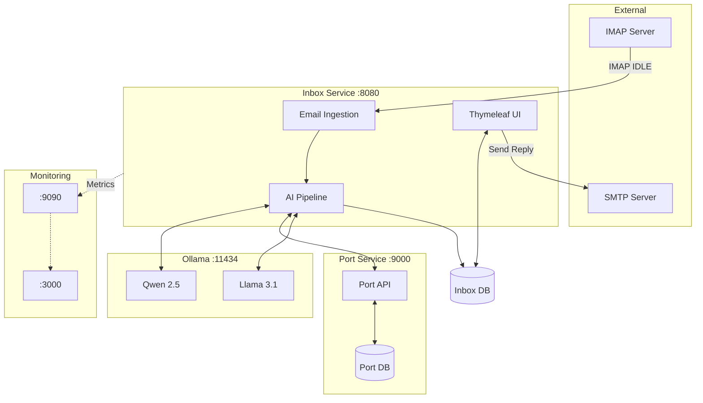

# Smart Freight Inbox — V1 MVP

**AI-powered logistics email processing system.**

Incoming freight enquiry emails are automatically processed: 
1. Container numbers are extracted from emails via **Qwen 2.5**.
2. The container is looked up in the dedicated **Port Service** (simulating external UK port databases).
3. A professional reply draft is generated by **Llama 3.1**.
4. Operators review the draft in the UI and can send the reply back to the customer with one click (via **SMTP**).

---

## 🚀 Quick Start (Full Docker Stack)

The entire application, including the databases, AI models, and monitoring stack, runs in Docker.

### Prerequisites
- Docker Desktop running (with enough RAM/VRAM allocated, minimum 16GB recommended for LLMs).
- Java 17+ and Maven 3.9+ (if running the Spring Boot app outside Docker).

### 1. Pull AI models (one-time)
If you haven't pulled the models to your local Ollama instance yet:
```bash
ollama pull qwen2.5:7b
ollama pull llama3.1:8b
```

### 2. Start the Stack
Run this command from the `inbox` directory:
```bash
docker-compose up --build
```
This will start:
- **inbox** (Main Spring Boot application)
- **port-service** (External API simulator for container statuses)
- **postgres** (Database for inbox)
- **port-db** (Database for port-service)
- **ollama** (Local LLM server)
- **prometheus** & **grafana** (Monitoring and dashboards)

---

## 🔐 Demo Access & Links

Once the stack is up, you can access the services here:

| Service | URL | Login Credentials |
|---------|-----|-------------------|
| **Web UI** | [http://localhost:8080/login](http://localhost:8080/login) | `operator@smartfreight.com` / `demo123` |
| **Grafana** | [http://localhost:3000](http://localhost:3000) | `admin` / `admin` (skip password change) |
| **Prometheus** | [http://localhost:9090](http://localhost:9090) | *(No auth)* |
| **Actuator Health** | [http://localhost:8080/actuator/health](http://localhost:8080/actuator/health) | *(No auth)* |
| **Port Service API** | [http://localhost:9000/api/containers/MSCU1234567](http://localhost:9000/api/containers/MSCU1234567) | *(No auth)* |

*Note: Grafana is pre-provisioned with the "Smart Freight Inbox" dashboard out of the box.*

---

## 🏗️ Architecture



---

## ⚙️ Environment Variables (Email Configuration)

To test with real emails, configure your IMAP/SMTP credentials. You can set these in a `.env` file or in your IDE Run Configuration:

| Variable | Default | Description |
|----------|---------|-------------|
| `IMAP_HOST` | `imap.example.com` | IMAP server hostname (e.g., `imap.gmail.com`) |
| `IMAP_PORT` | `993` | IMAP SSL port |
| `IMAP_USER` | `inbox@example.com` | Mailbox username |
| `IMAP_PASSWORD` | `changeme` | Mailbox password (or App Password) |
| `SMTP_HOST` | `smtp.gmail.com` | SMTP server hostname |
| `SMTP_PORT` | `587` | SMTP port (STARTTLS) |
| `SMTP_USER` | *(Same as IMAP_USER)* | SMTP username |
| `SMTP_PASSWORD`| *(Same as IMAP_PASSWORD)*| SMTP password |

*See `.env.example` for Mailtrap/Gmail examples.*

---

## 🔌 REST API (Programmatic Access)

### Login
```http
POST /api/auth/login
Content-Type: application/json

{ "email": "operator@smartfreight.com", "password": "demo123" }
```
Response: `{ "token": "eyJhbGci..." }`

### Tickets
| Method | Path | Purpose |
|--------|------|---------|
| `GET` | `/api/tickets` | List tickets (optional `?status=DRAFT_READY`) |
| `GET` | `/api/tickets/{id}` | Get ticket by id |
| `PATCH` | `/api/tickets/{id}/draft` | Edit draft. Body: `{ "draftReply": "...", "close": false }` |
| `POST` | `/api/tickets/{id}/approve` | Mark ticket as `CLOSED` (without sending) |
| `POST` | `/api/tickets/{id}/reject` | Send ticket back to `RETRY_LATER` |

---

## 📦 Technology Stack

| Layer | Technology |
|-------|-----------|
| **Framework** | Spring Boot 4.0.5, Java 17 |
| **Databases** | PostgreSQL 16, Flyway migrations |
| **AI Models** | Ollama, Qwen 2.5:7b, Llama 3.1:8b |
| **Integration** | Spring Integration (IMAP IDLE), Spring WebClient |
| **Security** | Spring Security + JWT |
| **Frontend** | Thymeleaf + Bootstrap 5 |
| **Monitoring** | Micrometer, Prometheus, Grafana |
