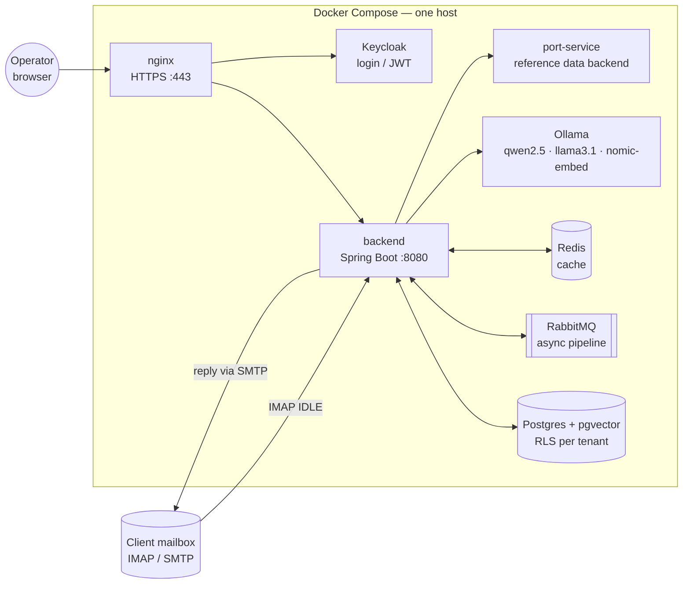

# SmartFreight Inbox

**AI email automation that keeps customer data on UK servers.** Incoming customer emails are read
from the client's own mailbox, classified and grounded in the client's data by a **local LLM**
(Ollama — nothing goes to a US cloud), and turned into reply drafts that an operator reviews and
sends with one click — or that go out automatically once confidence is high enough.

First vertical: UK freight and haulage (container / job-status enquiries, quote requests, document
requests). The pipeline itself is vertical-neutral.



## Quick start (local)

**Prerequisites:** Docker Desktop (≥ 16 GB RAM for the stack), an NVIDIA GPU with ~16 GB VRAM for
Ollama (compose reserves one; without a GPU the models run on CPU — slowly). Java 17 + Node 20 only
if you build outside Docker.

```bash
git clone <repo> && cd inbox
docker compose up -d --build        # first run pulls the models (~10 GB) — see `docker compose logs -f ollama`
```

Then open **https://localhost** (self-signed certificate on a fresh clone — accept it, or drop an
[mkcert](https://github.com/FiloSottile/mkcert) pair into `monitoring/nginx/certs/`) and sign in as
the seeded platform admin `operator@smartfreight.com` / `Operator1Pass`.

A fresh clone needs **no `.env` and no secrets**: every secret falls back to the public dev values in
[`secrets.dev/`](secrets.dev/README.md). Real deployments keep secrets as files outside the repo —
[`docs/ops/secrets.md`](docs/ops/secrets.md).

### Seeing it work without a real mailbox — the demo mail harness

```bash
# .env
COMPOSE_PROFILES=demo
DEMO_MAIL_ENABLED=true
```

`docker compose up -d` then adds **GreenMail** (fake customer inboxes) and **Mailpit**
(http://localhost:8025 — what the customer receives). Feed it realistic emails with
`powershell -ExecutionPolicy Bypass -File scripts\demo-mail.ps1` (its header is the full how-to) and
watch tickets appear live on `/tickets`.

Demo *data* (two demo tenants, rates, documents, a quarter of tickets for the analytics pages) lives
in `src/main/resources/db/dev-seed` and is applied only under the `dev` Spring profile — Docker runs
`prod`. Run the backend once from the IDE with `SPRING_PROFILES_ACTIVE=dev` against the compose
database (`localhost:5433`), or load the files with `psql`.

### Useful URLs

| What | URL | Notes |
|---|---|---|
| App (SPA + API) | https://localhost | via nginx; `http://localhost:8080` is the backend directly |
| Mailpit | http://localhost:8025 | demo profile only |
| Grafana | http://localhost:3000 | admin / admin (dev) |
| RabbitMQ | http://localhost:15672 | smartfreight / smartfreight (dev) |
| Prometheus | http://localhost:9090 | |

All host ports except nginx's 443/8443 are bound to `127.0.0.1`.

## Working on the code

| Task | Command |
|---|---|
| Backend tests (Testcontainers — Docker must be running) | `./mvnw -DskipFrontend test` |
| One test class | `./mvnw -DskipFrontend test -Dtest=TicketProcessingClassificationTest` |
| Frontend dev server (proxies `/api`, `/ws`) | `cd frontend && npm install && npm run dev` |
| Frontend build / lint | `npm run build` · `npm run lint` |
| Rebuild + redeploy the backend after a change | `docker compose build backend && docker compose up -d backend` |

`./mvnw package` also builds the SPA into the jar (`-DskipFrontend` skips it).

### Where things are

```
src/main/java/com/smartfreight/inbox/
  integration/   IMAP IDLE adapters, ingestion, catch-up, mailbox health      ← email comes in here
  messaging/     transactional outbox → RabbitMQ → consumer                    ← async hand-off
  service/       the pipeline: classification, extraction, drafting, auto-send,
                 proactive updates, analytics, RAG, Keycloak provisioning
  tenancy/       TenantContext, RLS session variables, tenant resolution      ← read this early
  controller/    REST API (/api/*) consumed by the SPA
  scheduler/     retries, SLA breaches, proactive watches, follow-ups
  entity/ repository/   JPA model (one tenant_id on every business table)
  webhook/       outbound CRM webhooks (HMAC-signed, outbox-delivered)
src/main/resources/db/migration   Flyway (prod) · db/dev-seed (dev only)
frontend/        Vite + React + TypeScript SPA
port-service/    reference backend the pipeline looks items up in (simulates a client TMS)
keycloak/        realm import (clients, roles, password policy, user profile)
monitoring/      nginx, Prometheus rules, Alertmanager, Grafana, backups
scripts/         ops scripts (secrets, restore test, tenant erasure, demo mail)
docs/            architecture, decisions, ops runbooks
```

## Read next

1. **[docs/ARCHITECTURE.md](docs/ARCHITECTURE.md)** — how the system works today: the email's path,
   multi-tenancy, security, AI, glossary. Start here.
2. **[docs/adr/](docs/adr/README.md)** — why it is built this way, one decision per page.
3. **[docs/ops/](docs/ops/)** — runbooks: secrets, backups + restore, alerting, data flow (DPA
   annex), tenant erasure.
4. [ROADMAP.md](ROADMAP.md) — product roadmap and pilot-readiness gates (in Russian).

## Tech stack

Java 17 · Spring Boot 4 · Spring Integration (IMAP IDLE) · PostgreSQL 16 + pgvector · Flyway ·
RabbitMQ 3.13 · Redis 7 · Keycloak 26 (OIDC, PKCE) · Ollama (qwen2.5:7b, llama3.1:8b,
nomic-embed-text) · Resilience4j · Micrometer + Prometheus + Grafana · React 19 + Vite + Bootstrap 5 ·
Testcontainers · Docker Compose.
