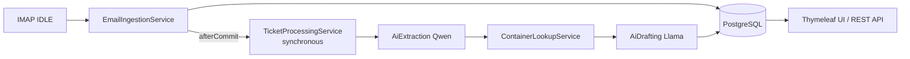
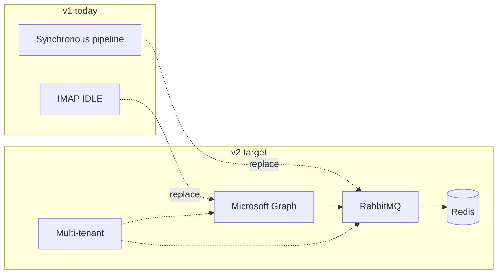

# Agent handoff: Smart Freight Inbox — v1 vs v2

**Назначение (RU):** этот файл — единый пакет для передачи другому ИИ-агенту на анализ: отдельно описание и дерево **v1** (текущая реализация) и **v2** (целевой план). Детальный план v2 остаётся в [`V2_ARCHITECTURE_AND_PLAN.md`](./V2_ARCHITECTURE_AND_PLAN.md); диаграммы для презентаций — в [`PRESENTATION_TREE_MAP.md`](./PRESENTATION_TREE_MAP.md).

**Purpose (EN):** self-contained brief for downstream agents: **v1** = what exists in repo today; **v2** = planned evolution. Do not treat v2 trees as existing code unless `src/main/java/.../v2/` appears.

---

## Part A — Version 1 (MVP, implemented)

### A.1 Description

**Product goal:** ingest logistics-related email, deduplicate by `Message-ID`, persist as `EmailTicket`, run a synchronous AI pipeline (extract container number via local LLM, look up container in PostgreSQL, draft reply via second LLM), surface results via Thymeleaf UI and REST API for the operator.

**Runtime stack:**

- Java 17, **Spring Boot 4.0.5**, Spring Data JPA, Flyway
- PostgreSQL (schema `V1__init.sql`, seeds `V2__seed_demo_containers.sql`, `V3__fix_demo_user_password.sql`, `V4__seed_test_tickets.sql`)
- Spring Integration **IMAP IDLE** for mail (`ImapConfig`, `EmailIngestionService`)
- **Ollama** over HTTP: Qwen (extraction), Llama (drafting) — `WebClientConfig`, `AiExtractionService`, `AiDraftingService`
- Spring Security + JWT (`JwtService`, `JwtAuthenticationFilter`, `SecurityConfig`) — stateless, JWT in `Authorization` header (REST) or httpOnly cookie (UI)
- **Synchronous** processing: `TicketProcessingService.process(ticketId)` runs in the caller's thread. `EmailIngestionService` schedules it via `TransactionSynchronization.afterCommit()` so the DB transaction for email intake is committed before the long LLM calls start.
- Retries: `RetryScheduler` periodically picks up tickets in `RETRY_LATER` (operator reject)
- UI: Thymeleaf + Bootstrap 5 (`templates/login.html`, `tickets.html`, `ticket-detail.html`)
- REST API: `AuthController` (`POST /api/auth/login`) and `TicketController` (`GET /api/tickets`, `GET /api/tickets/{id}`, `POST /api/tickets/{id}/approve`, `POST /api/tickets/{id}/reject`)
- Admin ops: `AdminController` `POST /admin/reprocess` (localhost-only, synchronous)
- Observability: Actuator, `OllamaHealthIndicator`, Docker Compose includes Prometheus/Grafana wiring (`docker-compose.yml`, `monitoring/prometheus.yml`)

**Main data flow:**

1. Mail server → IMAP IDLE channel → `EmailIngestionService` (parse MIME body, dedup by Message-ID) → save `EmailTicket` (`NEW`)
2. After commit (same thread): `TicketProcessingService.process` → `PROCESSING` → `AiExtractionService` → `ContainerLookupService` → `AiDraftingService` → `DRAFT_READY` or `FAILED`
3. Operator reviews draft in UI / REST → `approve` → `CLOSED`, or `reject` → `RETRY_LATER` (picked up by `RetryScheduler`)

**Ticket statuses (see `TicketStatus`):** `NEW`, `PROCESSING`, `DRAFT_READY`, `FAILED`, `RETRY_LATER`, `CLOSED`.

**Known notes for agents:**

- No message broker: scaling is a single instance. An incoming IMAP message blocks the integration thread until Ollama finishes. Acceptable for the demo; replaced by RabbitMQ in v2.
- No SMTP send-out yet: operator closes the ticket; outbound reply is a planned extension.
- `AuthController` contains a temporary demo-bypass for `operator@smartfreight.com` / `demo123` (BCrypt mismatch workaround) — remove before any non-demo use.

**Canonical package root:** `com.smartfreight.inbox` (no `v2` subpackage in v1).

### A.2 Repository tree map (v1 — actual files)

```
inbox/   (project root)
├── pom.xml
├── docker-compose.yml
├── docs/                               (see other files in this folder)
├── monitoring/
│   └── prometheus.yml
├── scripts/
│   ├── entrypoint.sh
│   ├── github-push.ps1
│   └── verify-imap-ready.ps1
└── src/
    ├── main/
    │   ├── java/com/smartfreight/inbox/
    │   │   ├── InboxApplication.java
    │   │   ├── actuator/OllamaHealthIndicator.java
    │   │   ├── config/
    │   │   │   ├── ImapConfig.java
    │   │   │   ├── SecurityConfig.java
    │   │   │   └── WebClientConfig.java
    │   │   ├── controller/
    │   │   │   ├── AdminController.java        (POST /admin/reprocess, localhost-only)
    │   │   │   ├── AuthController.java         (POST /api/auth/login)
    │   │   │   ├── TicketController.java       (GET/POST /api/tickets[/{id}/{approve|reject}])
    │   │   │   └── TicketViewController.java   (Thymeleaf UI)
    │   │   ├── entity/
    │   │   │   ├── Container.java
    │   │   │   ├── EmailTicket.java
    │   │   │   ├── User.java
    │   │   │   └── enums/TicketStatus.java
    │   │   ├── repository/
    │   │   │   ├── ContainerRepository.java
    │   │   │   ├── EmailTicketRepository.java
    │   │   │   └── UserRepository.java
    │   │   ├── integration/
    │   │   │   └── EmailIngestionService.java  (schedules process() via afterCommit)
    │   │   ├── service/
    │   │   │   ├── AiExtractionService.java
    │   │   │   ├── AiDraftingService.java
    │   │   │   ├── AuthService.java
    │   │   │   ├── ContainerLookupService.java
    │   │   │   └── TicketProcessingService.java (synchronous)
    │   │   ├── scheduler/
    │   │   │   └── RetryScheduler.java
    │   │   ├── security/
    │   │   │   ├── JwtService.java
    │   │   │   └── JwtAuthenticationFilter.java
    │   │   └── exception/
    │   │       ├── GlobalExceptionHandler.java
    │   │       └── ContainerNotFoundException.java
    │   └── resources/
    │       ├── application.yaml
    │       ├── templates/
    │       │   ├── login.html
    │       │   ├── tickets.html
    │       │   └── ticket-detail.html
    │       └── db/migration/
    │           ├── V1__init.sql
    │           ├── V2__seed_demo_containers.sql
    │           ├── V3__fix_demo_user_password.sql
    │           └── V4__seed_test_tickets.sql
    └── test/java/com/smartfreight/inbox/
        ├── InboxApplicationTests.java
        ├── TestInboxApplication.java
        ├── TestcontainersConfiguration.java
        └── service/TicketProcessingServiceTest.java
```

### A.3 Logical pipeline (v1 — for comparison with v2)



---

## Part B — Version 2 (planned, not necessarily implemented)

### B.1 Description

**Purpose:** production-grade, **multi-tenant**, horizontally scalable evolution: replace IMAP with **Microsoft Graph**, replace in-process async with **RabbitMQ** consumers, add **Redis** (cache, rate limits, locks, optional refresh-token storage), strengthen **resilience** (circuit breaker, retry, bulkhead), improve **observability** (OpenTelemetry + existing metrics stack), optional **Angular** operator UI with tenant switching.

**Team constraints (from canonical v2 doc):**

- **v1 must not be broken** without an explicit task; implement **v2 in isolation** (e.g. package `com.smartfreight.inbox.v2`).
- Message broker choice is **RabbitMQ** (not Kafka) for this project.

**Phased rollout (summary):**

1. Messaging: RabbitMQ, producer/consumer, DLQ  
2. Ingestion: Graph webhooks + delta sync  
3. Redis: config, distributed lock, rate limiter, tokens if needed  
4. Multi-tenancy: `tenant_id`, filters, JWT claims  
5. Resilience4j around Ollama and external calls  
6. OpenTelemetry traces across queue → worker → DB  
7. UI: multi-tenant login, SLA dashboards  

Full detail: [`V2_ARCHITECTURE_AND_PLAN.md`](./V2_ARCHITECTURE_AND_PLAN.md).

### B.2 Target package tree map (v2 — planned layout)

```
src/main/java/com/smartfreight/inbox/v2/
├── config/
│   ├── TenantConfig.java
│   ├── RedisConfig.java
│   ├── RabbitConfig.java
│   ├── GraphApiConfig.java
│   ├── ResilienceConfig.java
│   └── OpenTelemetryConfig.java
├── ingestion/
│   ├── GraphWebhookController.java
│   ├── GraphDeltaService.java
│   └── EmailNormalizationService.java
├── queue/
│   ├── TicketProducer.java
│   ├── TicketConsumer.java
│   └── DeadLetterHandler.java
├── processing/
│   ├── ExtractionWorker.java
│   ├── DraftingWorker.java
│   └── ContainerLookupWorker.java
├── tenant/
│   ├── TenantResolver.java
│   ├── TenantContext.java
│   └── TenantFilter.java
├── security/
│   ├── JwtTenantFilter.java
│   └── RefreshTokenService.java
└── util/
    ├── RateLimiter.java
    └── DistributedLock.java
```

### B.3 Target runtime tree map (v2 — logical components)

```
Microsoft Graph API
        │
        ▼
Graph ingestion (webhook / delta) ──normalize──► RabbitMQ (ticket queue)
        │                                              │
        │                                              ▼
        │                                   Ticket consumer(s) / workers
        │                                              │
        │                    ┌─────────────────────────┼─────────────────────────┐
        │                    ▼                         ▼                         ▼
        │              Extraction (Qwen)         Container lookup           Drafting (Llama)
        │                    │                         │                         │
        │                    └─────────────────────────┴─────────────────────────┘
        │                                              │
        │                                              ▼
        └──────────────────────────────────► PostgreSQL + Redis
                                                       │
                                                       ▼
                                              Operator UI (Angular, multi-tenant)
```

### B.4 v1 → v2 delta (one diagram)



---

## Instructions for the receiving agent

1. **Scope:** State explicitly whether analysis applies to **v1 codebase**, **v2 plan**, or **migration** from v1 to v2.  
2. **Source of truth:** v2 package/file names above are **targets**; verify against `V2_ARCHITECTURE_AND_PLAN.md` before implementing.  
3. **Reality check:** List `src/main/java/com/smartfreight/inbox/` — if there is **no** `v2/` directory, v2 is **not** implemented as a separate module yet.  
4. REST API and Thymeleaf UI **do exist** in v1 today — see controllers listed in A.2.

---

*Last updated for agent handoff. Regenerate the file trees if the repository layout changes materially.*
