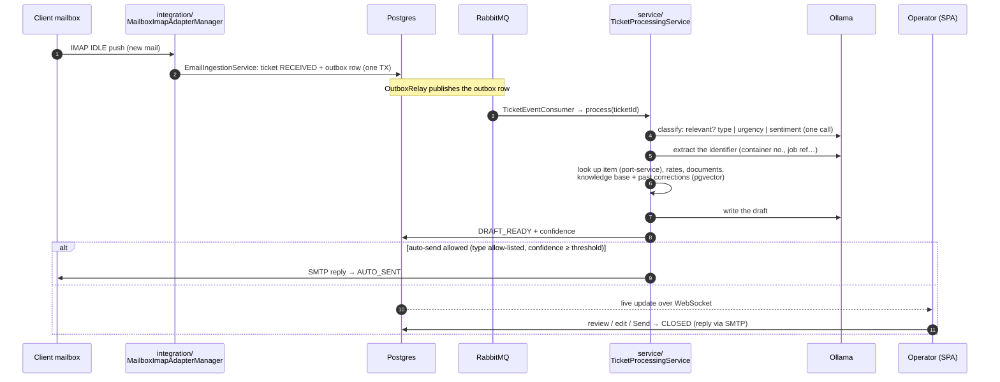

# Architecture

How SmartFreight Inbox works **today**. The reasons behind the main choices are in
[`adr/`](adr/README.md); this page describes the result. Terms in *italics* are in the
[glossary](#glossary) at the end.

## 1. The big picture

One Spring Boot application (`backend`, this repo's root) does all the work. It reads the client's
mailbox, runs each email through an AI pipeline and serves a React SPA plus a REST API. Everything
else in `docker-compose.yml` is infrastructure around it:

| Component | Role |
|---|---|
| **backend** | IMAP ingestion, pipeline, REST API (`/api/*`), WebSocket (`/ws`), schedulers |
| **nginx** | the only public entry point: TLS, rate limits, security headers; routes `/` → backend, `/realms` → Keycloak |
| **Postgres + pgvector** | all business data; Row-Level Security isolates *tenants*; vectors for RAG |
| **RabbitMQ** | hands a *ticket* from ingestion to the pipeline (via a transactional outbox) |
| **Redis** | rate-sheet cache |
| **Keycloak** | users, roles, login (OIDC + PKCE); the backend validates its JWTs |
| **Ollama** | local LLMs: `qwen2.5:7b` (classify / extract), `llama3.1:8b` (write), `nomic-embed-text` (embeddings) |
| **port-service** | separate Spring app + DB: the reference data the pipeline looks items up in (simulates a client's TMS) |
| Prometheus, Alertmanager, Grafana | metrics, alerts (Telegram + dead man's switch) |
| backup containers | daily `pg_dump`s, encrypted offsite copy |

## 2. The path of one email



Step by step, with the class to open:

1. **Ingestion** — `integration/MailboxImapAdapterManager` runs one IMAP IDLE adapter per enabled
   mailbox row (`tenant_mailbox`), rebuilt every 30 s from the DB by `scheduler/MailboxReconciler`,
   so a newly connected mailbox needs no restart. IDLE takes only mail received since the mailbox was
   connected. `EmailIngestionService` dedups by Message-ID, parses attachments (PDF/Excel → text) and
   saves the ticket as `RECEIVED`. No LLM runs on the IMAP thread.
2. **Hand-off** — the ticket and an `outbox_event` row are written in **one** DB transaction;
   `messaging/OutboxRelay` publishes to RabbitMQ with confirms. Delivery is at-least-once, so the
   consumer is idempotent (it only acts on `RECEIVED`/`NEW`/`RETRY_LATER`).
3. **Pipeline** — `service/TicketProcessingService.processAttempt`:
   - **classify** (`EmailClassificationService`): junk → `IRRELEVANT` (kept for audit); otherwise a
     *ticket type* plus urgency and sentiment. *Escalated* tickets get a tighter SLA, float to the
     top of the list and can be auto-assigned.
   - **extract** the identifier (`AiExtractionService`, regex fallback per tenant).
   - **ground**: item status from the `ItemLookupService` (port-service), matching rates, an on-file
     document (`DOCUMENT_REQUEST`), knowledge-base articles and similar past corrections (RAG, see §5).
   - **draft** (`AiDraftingService`) and score a heuristic *confidence*.
   - **route** (`AutoSendService`): auto-send or leave `DRAFT_READY` for an operator.
4. **Review** — the SPA's `/tickets` list updates live (STOMP over `/ws`, refetch on signal). The
   operator edits and sends (`controller/TicketApiController`). The reply leaves through the mailbox
   the email came in on (`MailSenderProvider`) and is signed with the operator's name
   (`ReplySignatureService`).
5. **After sending** — an edited draft becomes a *training example* (feedback loop); a sent quote
   arms a follow-up; a status reply arms a *shipment watch* for proactive updates.

**Failure handling.** Each LLM endpoint and port-service sit behind a circuit breaker
(Resilience4j). When Ollama is down a ticket is parked `RETRY_LATER` without burning a retry, and
`RetryScheduler` resumes it. `StuckTicketSweeper` rescues tickets stuck mid-pipeline. Mail that IDLE
missed (crash, DB outage, read on a phone) is re-found by `MailboxCatchUp` on every health probe.

### Ticket states

```
RECEIVED → NEW → PROCESSING → DRAFT_READY → CLOSED       (operator sent / closed)
   │                  │             └──────→ AUTO_SENT    (sent without an operator)
   └→ IRRELEVANT      ├→ RETRY_LATER → (back to the pipeline)
                      └→ FAILED
```

## 3. Multi-tenancy — read this before touching data code

Every business table has a `tenant_id`. Isolation has **two layers**, and both must hold:

1. **Hibernate `@TenantId`** filters every entity query and stamps every insert.
2. **Postgres RLS** — policies read the session variables `app.tenant_id` / `app.is_system`, set on
   every connection checkout by `tenancy/TenantAwareDataSource`. RLS also catches native SQL and raw
   JDBC, which Hibernate does not see. The app connects as `smartfreight_app` (no superuser, no
   BYPASSRLS); only Flyway uses admin credentials.

The current tenant lives in `tenancy/TenantContext`:

| Where code runs | How the tenant is set |
|---|---|
| HTTP request | `TenantFilter` reads the JWT's `tenant_id` claim; no claim → fail-closed *anonymous* |
| Pipeline consumer | `tenantId` travels in the RabbitMQ message |
| IMAP adapter | `TenantContext.runAs(mailbox.tenantId, …)` around ingestion |
| Schedulers, outbox relay, metrics | `TenantContext.runAsSystem(…)` (cross-tenant), then per-tenant work inside `runAs` |

Rules that bite: an **unset context fails loudly** after startup (by design); the context must wrap
the **whole transaction** (Hibernate fixes the session tenant when the session opens, hence
`TransactionTemplate` inside `runAs…` rather than `@Transactional` on the caller). The `tenant`
table itself has no RLS — it is the catalogue the policies key on.

## 4. Security model

- **Login:** the browser signs in against Keycloak (OIDC authorisation code + PKCE, public client
  `smartfreight-spa`). The access token stays in memory and is renewed silently.
- **API:** `/api/**` is an OAuth2 resource server (stateless JWT). Roles from the realm:
  `OPERATOR` ⊂ `ADMIN` ⊂ `SUPER_ADMIN`. ADMIN manages its own tenant (mailboxes, settings, users,
  webhooks); SUPER_ADMIN onboards tenants. A tenant's first user is its ADMIN.
- **WebSocket:** authenticated on the STOMP CONNECT frame; a subscription must match the token's tenant.
- **Users** live only in Keycloak (`tenant_id` attribute + realm role), provisioned through the Admin
  REST API by `service/KeycloakAdminService` with a dedicated service-account client.
- **Secrets** are files mounted at `/run/secrets` (never env vars); mailbox passwords are AES-256-GCM
  encrypted in the DB (`SecretCipher`, key `MAILBOX_ENCRYPTION_KEY`).
- **Mail TLS** is verified (`MailTlsPolicy`); only the demo GreenMail/Mailpit hosts are relaxed, and
  only while the demo is on.
- **Edge:** nginx publishes 443 only; everything else is bound to `127.0.0.1`. CSP and other headers,
  `limit_req` on the app and on login. Actuator sits on a management port; only `/actuator/health`
  is exposed.
- **Logs** carry ids, never customer content (INFO and above); addresses are masked.

## 5. AI

| Call | Model | Where |
|---|---|---|
| relevance + type + urgency + sentiment | qwen2.5:7b | `EmailClassificationService` (one call) |
| identifier extraction | qwen2.5:7b | `AiExtractionService` |
| requested document type | qwen2.5:7b | `DocumentRequestService` |
| reply, proactive update, quote follow-up | llama3.1:8b | `AiDraftingService` |
| "Ask your inbox" routing / phrasing | qwen / llama | `InboxQueryService` |
| embeddings | nomic-embed-text | `EmbeddingService` |

- **Prompts** are settings (`app_setting`, overridable per tenant in `tenant_setting`) with
  placeholders: `{email}`, `{itemContext}`, `{rateContext}`, `{exampleContext}`, `{knowledgeContext}`.
  Trusted context is substituted first and untrusted email text last, so an email cannot inject a
  placeholder.
- **RAG, two sources**, ranked by pgvector cosine similarity within the tenant: past operator
  corrections (`training_example`, same ticket type) and knowledge-base articles (`knowledge_doc`,
  with a relevance threshold). The enquiry is embedded at most once per draft. Retrieval never breaks
  drafting — on any failure it simply adds nothing.
- **"Ask your inbox"** does not generate SQL: the LLM only *routes* a question to a fixed metric
  catalogue, the numbers are computed deterministically, and the LLM rephrases them.
- **Per-tenant LLM endpoint** (`ollama.base-url`): `OllamaClientProvider` keeps one client and one
  circuit breaker per endpoint. Every call records `smartfreight_llm_calls_total{tenant,model}`.
- The model never signs a reply; the real signature is added at send time.

## 6. Configuration and feature flags

Settings resolve **`tenant_setting` → `app_setting` → code default** inside `SettingsService`, so a
tenant can override any platform default from `/settings`. Feature flags use the same mechanism
(`feature.*`). Flags that email customers on their own default **OFF**: `feature.auto-send`,
`feature.status-update-automation`, `feature.quote-followup`. Flags whose output is always
operator-reviewed default ON.

## 7. Where to change what

| I want to… | Start in |
|---|---|
| change what happens to an email | `service/TicketProcessingService` |
| change a prompt | `/settings` → AI prompts (or the default in the Flyway migration that seeded it) |
| add a REST endpoint | `controller/*ApiController` + a DTO in `controller/dto` |
| add a table | a new `db/migration/V<next>__*.sql` with `tenant_id` + RLS policy + `@TenantId` on the entity, and add it to `scripts/erase-tenant.sh` |
| add a scheduled job | `scheduler/`, wrap in `TenantContext.runAsSystem` (one backend instance today — no distributed lock in the inbox; port-service uses ShedLock) |
| add a page | `frontend/src/pages`, route in `App.tsx`, data via `frontend/src/api/useApi.ts` |
| add an LLM call | go through `OllamaClientProvider` (breaker + `recordUsage` metering) |

## Glossary

| Term | Meaning |
|---|---|
| **Tenant** | one client organisation; every row and every user belongs to exactly one |
| **Ticket** | one inbound email (or one outbound *proactive* email) and its whole lifecycle |
| **Ticket type** | RFQ (quote request), STATUS_UPDATE, BOOKING_CONFIRM, INVOICE_QUERY, DOCUMENT_REQUEST, GENERAL |
| **Item / identifier** | the thing an email is about — a container number, a job reference — looked up via `ItemLookupService` |
| **Grounding** | the real data put into the drafting prompt: item status, rates, documents, knowledge, examples |
| **Confidence** | a deterministic heuristic (type known, identifier found, item found, rate matched), not an LLM score |
| **Auto-send gate** | flag + allowed types + confidence threshold; all three must pass |
| **Escalated** | HIGH urgency or negative tone → shorter SLA, top of the list, optional auto-assignment |
| **Proactive** | an email the system starts itself: a milestone status update (*shipment watch*) or a quote follow-up |
| **Training example** | an AI draft + what the operator actually sent; reused as a few-shot example |
| **SYSTEM context** | cross-tenant execution for schedulers / relay / metrics; never used for request handling |
| **Outbox** | `outbox_event` rows written with the business change and published to RabbitMQ afterwards |
| **Catch-up** | the periodic re-scan that ingests mail IDLE missed |
| **Golden set** | the scripted demo emails in `scripts/demo-mail.ps1`, also used to compare models |
