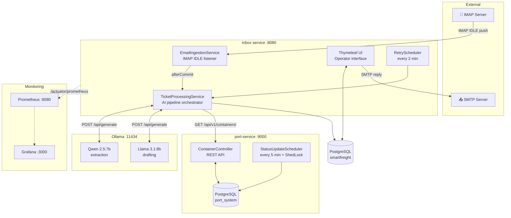
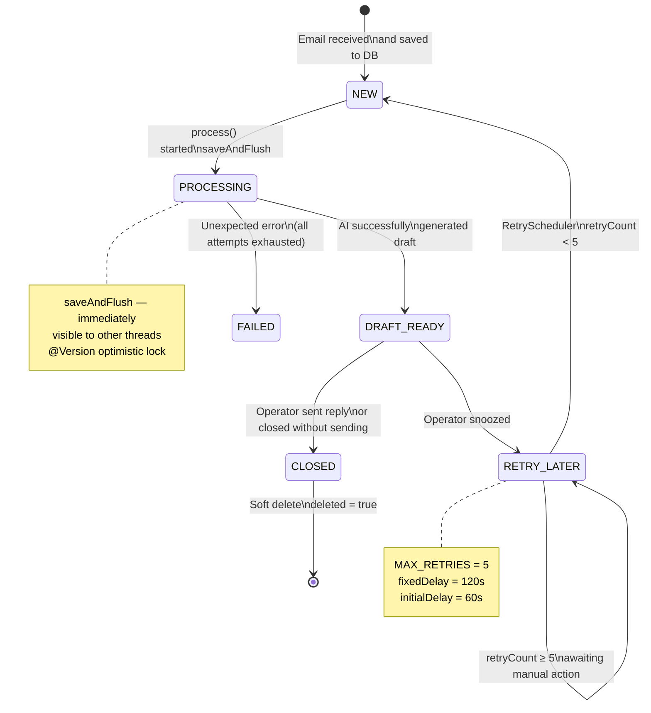
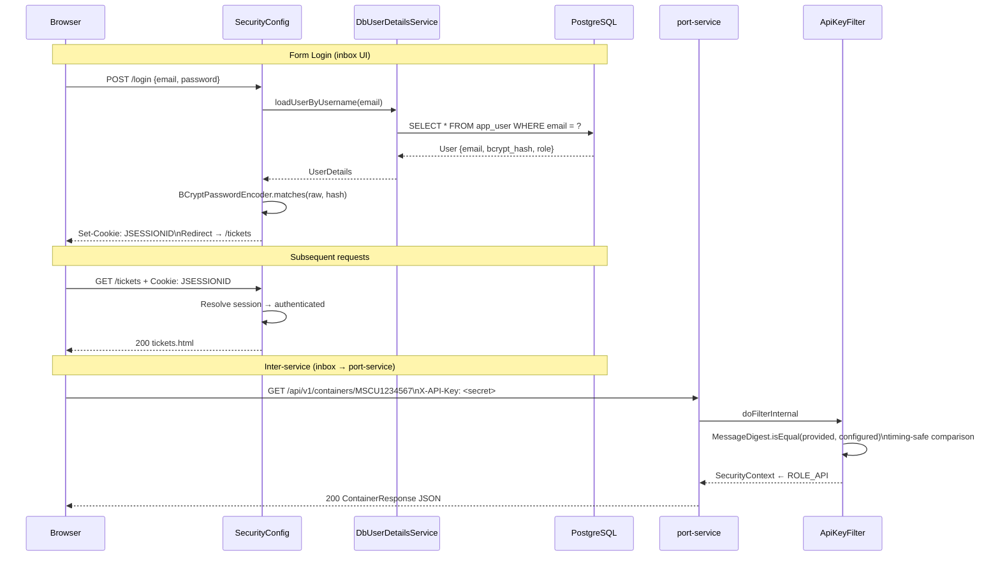
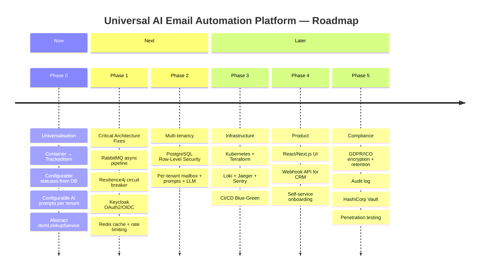
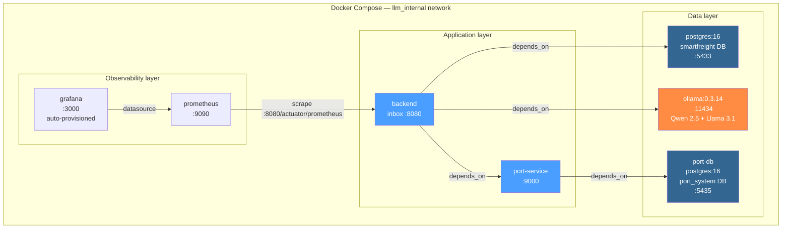

# Architecture Diagrams — SmartFreight Inbox

> All diagrams use [Mermaid](https://mermaid.js.org/) syntax.  
> Render in GitHub, IntelliJ, VS Code (Mermaid plugin), or [mermaid.live](https://mermaid.live).

---

## 1. System Overview

High-level view of all services and their interactions.



---

## 2. Email Processing Pipeline

Step-by-step flow from incoming email to operator review.

```mermaid
flowchart TD
    A([📧 New email arrives\nIMAP IDLE push]) --> B[EmailIngestionService\nprocessIncomingEmail]

    B --> C{System-generated\nemail?}
    C -->|Yes — our own draft header| Z1([🚫 Ignore\navoid infinite loop])

    C -->|No| D{Message-ID\npresent?}
    D -->|No — malformed email| Z2([🚫 Ignore])

    D -->|Yes| E[Copy to byte array\nByteArrayOutputStream\nguard against FolderClosedException]
    E --> F{Size > 10 MB?}
    F -->|Yes| Z3([🚫 Ignore\nprotect heap])

    F -->|No| G[EmailClassificationService\nQwen 2.5 — up to 30s\nRELEVANT / IRRELEVANT]

    G --> H{Relevant\nfreight enquiry?}
    H -->|IRRELEVANT| Z4([🚫 Ignore\nno DB touch])
    H -->|fail-open: Ollama down| I

    H -->|RELEVANT| I{Duplicate?\nfindByMessageId}
    I -->|Already exists| Z5([🚫 Ignore])

    I -->|New| J[Save EmailTicket\nstatus = NEW\nto PostgreSQL]
    J --> K[Register afterCommit hook\nTransactionSynchronizationManager]
    K --> L([Transaction committed\nDB connection released])

    L --> M[TicketProcessingService.process\nREQUIRES_NEW transaction]
    M --> N[status → PROCESSING\nsaveAndFlush — visible to all threads]

    N --> O["Step 1/3 — AiExtractionService\nQwen 2.5:7b — up to 150s"]
    O --> P{ISO 6346 number\nfound?}
    P -->|LLM returned clean result| Q[Container number\ne.g. MSCU1234567]
    P -->|LLM added extra text| R[Regex search in LLM response\n[A-Z]{4}\d{7}] --> Q
    P -->|LLM failed| S[Regex search in email body] --> Q
    S -->|Nothing found| Q2[extractedIdentifier = empty]

    Q --> T["Step 2/3 — ContainerLookupService\nHTTP GET port-service — up to 30s"]
    Q2 --> T
    T --> U{Container\nfound?}
    U -->|404 or error| V[container = null\nfail-open: continue]
    U -->|200 OK| W[Container: status, location, ETA]

    V --> X["Step 3/3 — AiDraftingService\nLlama 3.1:8b — up to 150s"]
    W --> X

    X --> Y{Ollama\nresponded?}
    Y -->|No| AB[Static fallback draft\nwith DB data]
    Y -->|Yes| AC[Professional reply draft\nin customer's language]

    AB --> AD[status = DRAFT_READY\nsave draftReply]
    AC --> AD

    AD --> AE[GmailDraftService\nsave to Drafts folder\nbest-effort]
    AD --> AF[Micrometer metrics\ndraftReadyCounter++\nprocessingTimer.record]

    AD --> AG([👤 Operator opens /tickets\nreviews draft])

    AG --> AH{Operator\ndecision}
    AH -->|Send| AI[EmailReplyService\nSMTP → customer\nIn-Reply-To header\nstatus → CLOSED]
    AH -->|Close| AJ([status = CLOSED\nno email sent])
    AH -->|Snooze| AK([status = RETRY_LATER])

    AK --> AL[RetryScheduler\nevery 2 min]
    AL --> AM{retryCount < 5?}
    AM -->|Yes| AN[retryCount++\nstatus → NEW\nre-run process] --> M
    AM -->|No| AO([Stay RETRY_LATER\nmanual intervention needed])
```

---

## 3. Ticket State Machine



---

## 4. inbox — Package & Class Structure

```mermaid
flowchart TB
    subgraph root ["com.smartfreight.inbox"]
        APP[InboxApplication\n@SpringBootApplication\n@EnableScheduling]

        subgraph config ["config/"]
            IC[ImapConfig\nIMAP IDLE → mailChannel]
            SC[SecurityConfig\nform login + BCrypt\nCSRF enabled]
            WC[WebClientConfig\nollamaWebClient\nportServiceWebClient + X-API-Key]
            SMTP2[SmtpConfig\nJavaMailSender]
            DU[DbUserDetailsService\nloadUserByUsername]
        end

        subgraph integration ["integration/"]
            EIS[EmailIngestionService\n@ServiceActivator\nmailChannel → handleEmail]
        end

        subgraph service ["service/"]
            TPS[TicketProcessingService\n@Transactional REQUIRES_NEW\norchestrates steps 1-3]
            AES[AiExtractionService\nQwen 2.5:7b\nregex fallback]
            ADS[AiDraftingService\nLlama 3.1:8b\nstatic fallback]
            CLS[ContainerLookupService\nHTTP GET port-service\nnormalise → uppercase]
            ERS[EmailReplyService\nSMTP + threading headers]
            ECS[EmailClassificationService\nQwen 2.5 RELEVANT/IRRELEVANT\nfail-open]
            GDS[GmailDraftService\nIMAP APPEND → Drafts]
            UMS[UserManagementService\nBCrypt encode]
            SS[SettingsService\nAppSetting CRUD]
            TAS[TicketAuditService\nimmutable audit log]
            SRL[SendRateLimiter\nper-address throttle]
        end

        subgraph controller ["controller/"]
            TVC[TicketViewController\nGET /tickets\nPOST /tickets/id/draft\nclose / delete]
            AC[AdminController\nlocalhost-only\nPOST /admin/reprocess]
            UC[UserManagementController\nPOST /admin/users]
            SettC[SettingsController\nGET/POST /settings]
        end

        subgraph scheduler ["scheduler/"]
            RS[RetryScheduler\n@Scheduled fixedDelay=120s\nRETRY_LATER → NEW]
        end

        subgraph actuator ["actuator/"]
            OHI[OllamaHealthIndicator\nGET /api/tags\nchecks both models]
            TMB[TicketMetricsBinder\nGauge per TicketStatus\nCounter draft/failed/retry]
        end

        subgraph entity ["entity/"]
            ET[EmailTicket\n@Version optimistic lock\n@SQLDelete soft delete\n@SQLRestriction deleted=false]
            US[User\nBCrypt password]
            AS2[AppSetting\nkey-value config]
            TAL[TicketAuditLog\nimmutable audit trail]
            TS[enums/TicketStatus\nNEW PROCESSING DRAFT_READY\nFAILED RETRY_LATER CLOSED]
        end

        subgraph startup ["startup/"]
            STR[StuckTicketRecovery\n@EventListener ApplicationReady\nPROCESSING → NEW on restart]
        end
    end
```

---

## 5. port-service — Package & Class Structure

```mermaid
flowchart TB
    subgraph root ["com.smartfreight.port_service"]
        APP2[PortServiceApplication\n@SpringBootApplication\n@EnableScheduling\n@EnableSchedulerLock]

        subgraph config2 ["config/"]
            SC2[SecurityConfig\nstateless REST\nCSRF disabled\nApiKeyFilter before UsernamePasswordFilter]
            AKF[ApiKeyFilter\nOncePerRequestFilter\nX-API-Key header\ntiming-safe MessageDigest.isEqual]
            AKV[ApiKeyStartupValidator\nfail-fast on dev-local-key\nin prod profile]
            SLC[ShedLockConfig\nJdbcTemplateLockProvider\nusingDbTime]
        end

        subgraph controller2 ["controller/"]
            CC[ContainerController\nGET /api/v1/containers/{number}\n200 ContainerResponse\n404 ProblemDetail]
        end

        subgraph service2 ["service/"]
            CS[ContainerService\nnormalise: trim + toUpperCase\nOptional ContainerResponse]
        end

        subgraph entity2 ["entity/"]
            CON[Container\n@Entity]
            CST[ContainerStatus enum\nIN_TRANSIT → AT_PORT\nCUSTOMS → RELEASED → DELIVERED]
        end

        subgraph dto ["dto/"]
            CR[ContainerResponse\nJava record\n@JsonFormat timestamps\nfrom entity factory method]
        end

        subgraph scheduler2 ["scheduler/"]
            SUS[StatusUpdateScheduler\n@Scheduled fixedDelay=5min\n@SchedulerLock lockAtLeast=4min\nrandom 1-2 containers\ncyclic status advance]
        end

        subgraph exception2 ["exception/"]
            CNF[ContainerNotFoundException]
            GEH[GlobalExceptionHandler\nRFC 7807 ProblemDetail]
        end
    end
```

---

## 6. Authentication & Security



---

## 7. Observability Pipeline

```mermaid
flowchart LR
    subgraph App ["inbox :8080"]
        MB[TicketMetricsBinder\nGauge per status\nCounter draft/fail/retry]
        TPS2[TicketProcessingService\ntimer.record duration]
        OHI2[OllamaHealthIndicator\nstatus UP/DOWN]
        ACT[/actuator/prometheus]
        MB --> ACT
        TPS2 --> ACT
        OHI2 --> ACT
    end

    ACT -->|scrape every 15s| PR[Prometheus :9090\ntime-series storage]
    PR -->|PromQL queries| GF[Grafana :3000\npre-provisioned dashboard]

    subgraph Dashboard ["Grafana panels"]
        P1[Tickets by status\npie chart]
        P2[Avg processing time\nNEW → DRAFT_READY]
        P3[Retry count total]
        P4[Ollama health\nUP / DOWN]
        P5[Backlog\nNEW + RETRY_LATER]
    end

    GF --> Dashboard
```

---

## 8. Roadmap — Phase Overview



---

## 9. Docker Compose — Service Graph



---

*Last updated: 26 May 2026*
