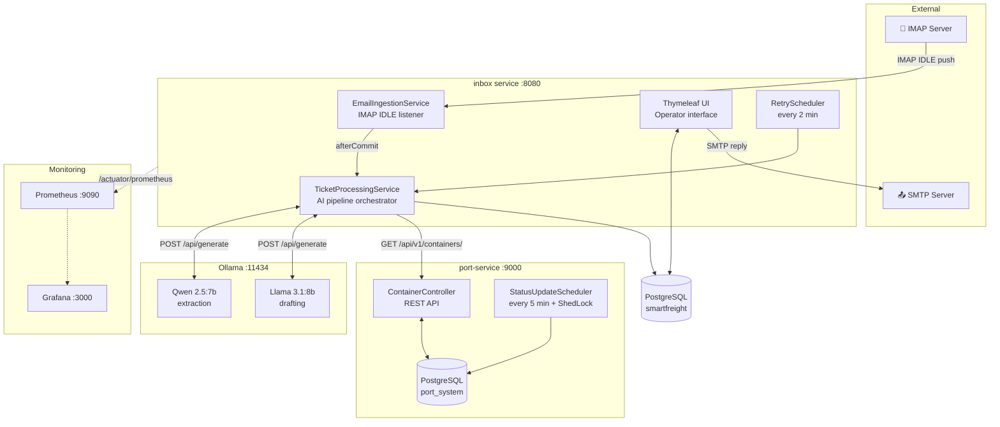
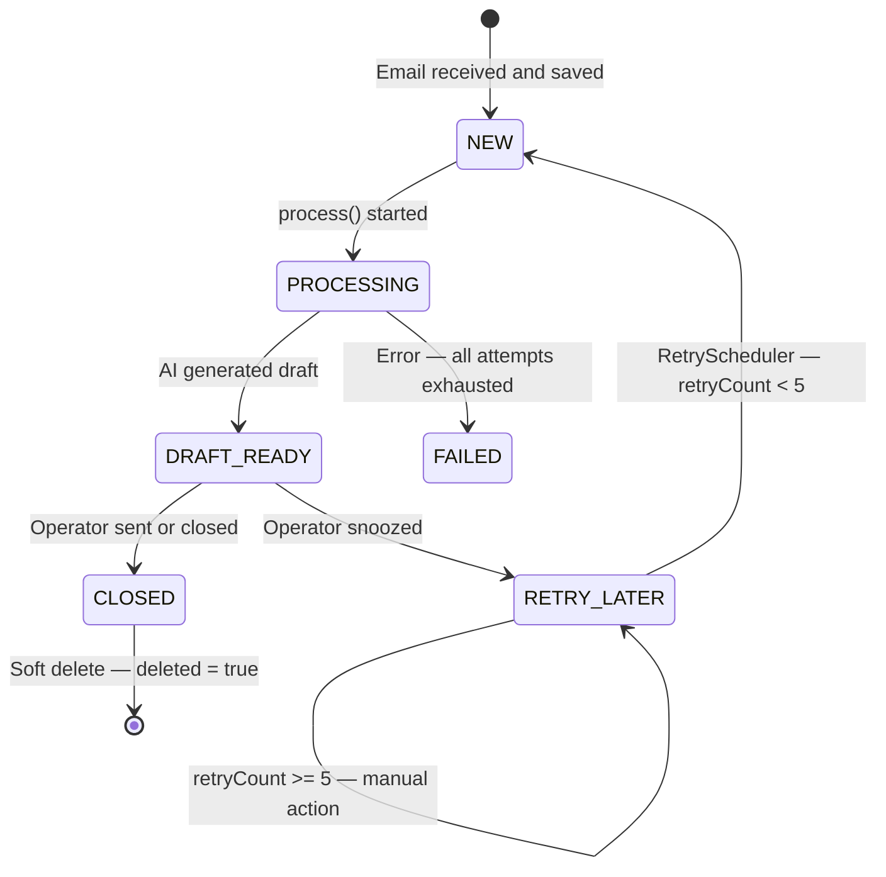
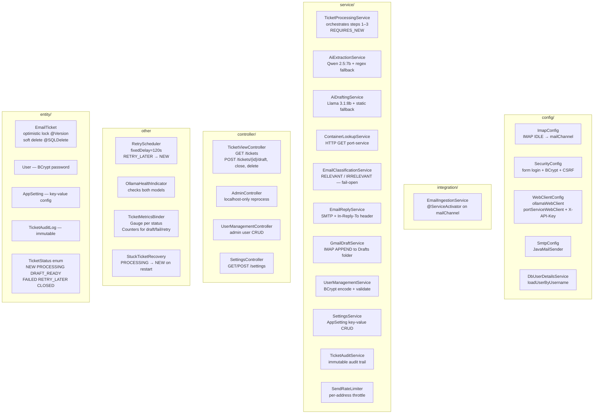
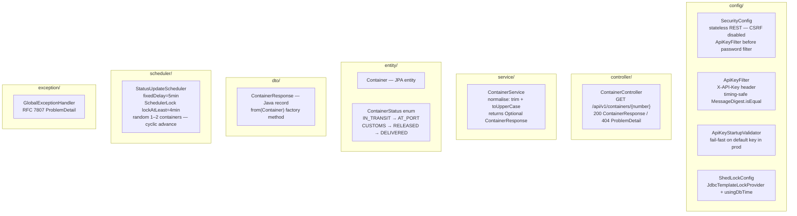
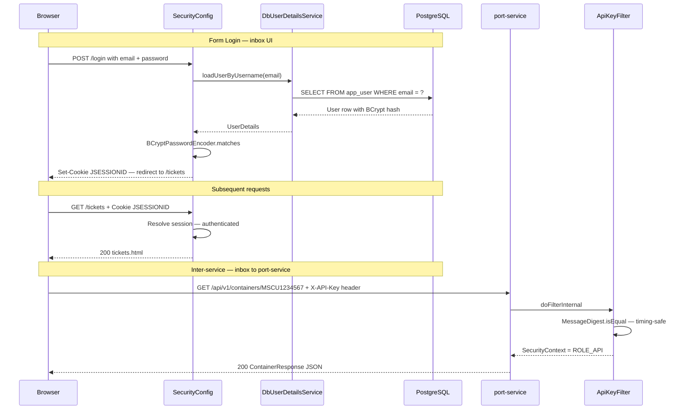
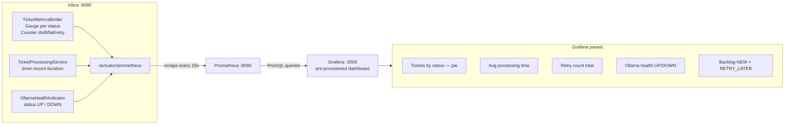
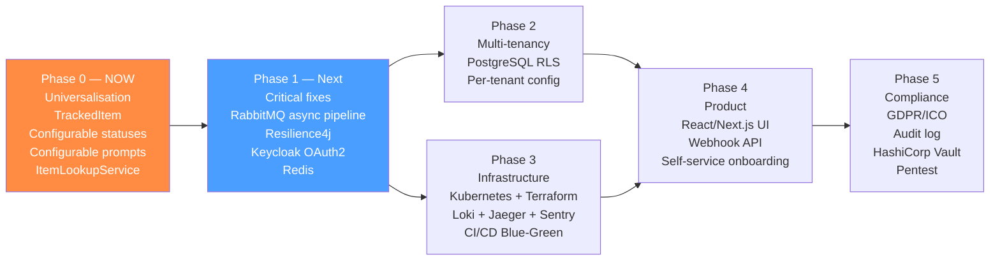
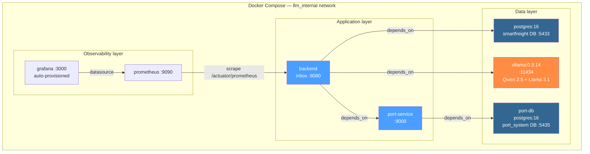

# Architecture Diagrams — SmartFreight Inbox

> All diagrams use [Mermaid](https://mermaid.js.org/) syntax.  
> Render in GitHub, IntelliJ, VS Code (Mermaid plugin), or [mermaid.live](https://mermaid.live).

---

## 1. System Overview

---

## 2. Email Processing Pipeline

```mermaid
flowchart TD
    A(["📧 New email\nIMAP IDLE push"]) --> B["EmailIngestionService"]

    B --> C{"System-generated\nemail?"}
    C -->|"Yes — draft header"| Z1(["🚫 Ignore\navoid loop"])
    C -->|"No"| D{"Message-ID\npresent?"}
    D -->|"No"| Z2(["🚫 Ignore"])
    D -->|"Yes"| E["Copy to byte array\nguard vs FolderClosedException"]

    E --> F{"Size > 10 MB?"}
    F -->|"Yes"| Z3(["🚫 Ignore"])
    F -->|"No"| G["EmailClassificationService\nQwen 2.5 — up to 30s"]

    G --> H{"Freight enquiry?"}
    H -->|"IRRELEVANT"| Z4(["🚫 Ignore"])
    H -->|"RELEVANT"| I{"Duplicate?\nfindByMessageId"}
    I -->|"Exists"| Z5(["🚫 Ignore"])
    I -->|"New"| J["Save EmailTicket\nstatus = NEW"]

    J --> K["Register afterCommit hook"]
    K --> L(["Transaction committed\nDB connection released"])
    L --> M["TicketProcessingService.process\nREQUIRES_NEW"]
    M --> N["status = PROCESSING\nsaveAndFlush"]

    N --> O["Step 1 — AiExtractionService\nQwen 2.5:7b — up to 150s"]
    O --> P{"Container number\nfound?"}
    P -->|"LLM clean result"| Q["e.g. MSCU1234567"]
    P -->|"LLM added extra text"| R["Regex in LLM response"] --> Q
    P -->|"LLM failed"| S["Regex in email body"] --> Q
    S -->|"Nothing found"| Q2["identifier = empty"]

    Q --> T["Step 2 — ContainerLookupService\nHTTP GET port-service"]
    Q2 --> T
    T --> U{"Container found?"}
    U -->|"404 or error"| V["container = null\nfail-open: continue"]
    U -->|"200 OK"| W["Container: status, location, ETA"]

    V --> X["Step 3 — AiDraftingService\nLlama 3.1:8b — up to 150s"]
    W --> X

    X --> Y{"Ollama\nresponded?"}
    Y -->|"No"| AB["Static fallback draft"]
    Y -->|"Yes"| AC["Professional reply draft\nin customer's language"]

    AB --> AD["status = DRAFT_READY\nsave draftReply"]
    AC --> AD

    AD --> AG(["👤 Operator reviews\n/tickets UI"])
    AG --> AH{"Decision"}
    AH -->|"Send"| AI["EmailReplyService\nSMTP → customer\nstatus = CLOSED"]
    AH -->|"Close"| AJ(["CLOSED\nno email sent"])
    AH -->|"Snooze"| AK(["RETRY_LATER"])

    AK --> AL["RetryScheduler\nevery 2 min"]
    AL --> AM{"retryCount < 5?"}
    AM -->|"Yes"| AN["retryCount++\nstatus = NEW"] --> M
    AM -->|"No"| AO(["Stay RETRY_LATER\nmanual action needed"])
```

---

## 3. Ticket State Machine

---

## 4. inbox — Package Structure

---

## 5. port-service — Package Structure

---

## 6. Authentication & Security

---

## 7. Observability Pipeline

---

## 8. Roadmap — Phase Overview

---

## 9. Docker Compose — Service Graph

---

*Last updated: 26 May 2026*
