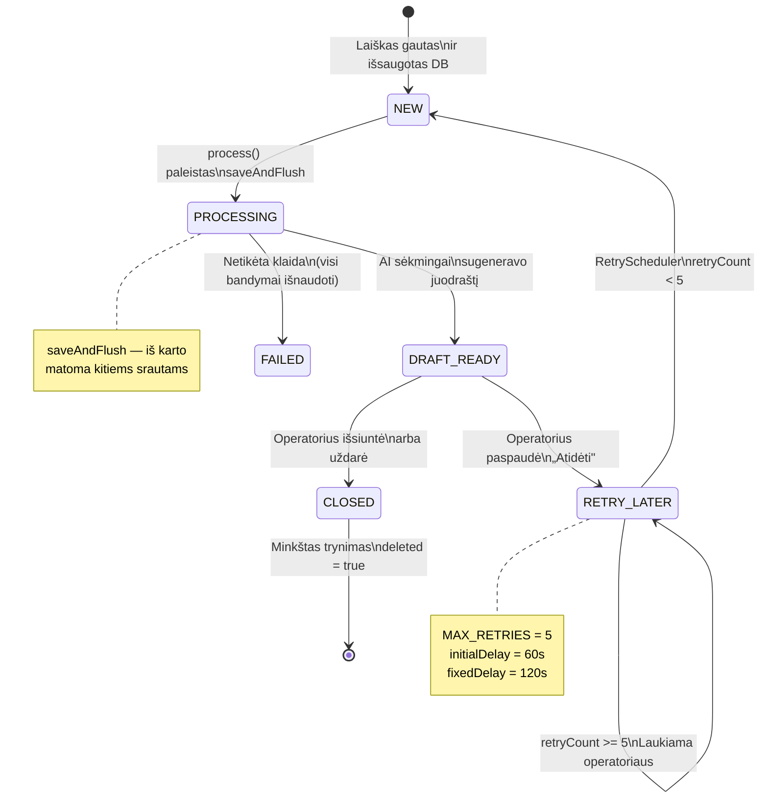

# Pilnas vieno laiško kelias: nuo Gmail iki atsakymo juodraščio

> Šis dokumentas aprašo visus vieno gaunamo laiško apdorojimo etapus SmartFreight Inbox sistemoje.
> Parengtas gynimui – kiekvienas žingsnis paaiškintas su pasirinkto metodo pagrindimu.

---

## Technologijų stekas ir priklausomybės

### Kodėl Java 17 ir Spring Boot 4.0.5?

**Java 17** — stabilus LTS (Long Term Support) leidimas, kuriame yra:
- Moderni virtualioji mašina (GC optimizacijos, našumo pagerinimas)
- Text blocks (triple-quote eilutės) — patogūs dideliems LLM prompt'ams
- Record'ai — glaustas kodas vietoj `@Data` anotacijos (pvz. `ContainerResponse`)
- Sealed classes — daugiau tipo saugos

**Spring Boot 4.0.5** — naujausias major versijos leidimas (2026 m.):
- Spring 6.x branduolys su patobulinta Spring Integration (IMAP IDLE)
- Virtual Threads (Project Loom) palaikymas
- Modernūs saugos šablonai (Spring Security 6.x)
- Jakarta EE 10 (ne senoji `javax.*`, o naujoji `jakarta.mail.*`)

Alternatyva būtų Python + FastAPI (greitesnis kūrimas), tačiau:
- Lygiagretaus apdorojimo poreikis (10+ lygiagrečių laiškų, 150 s LLM skirtasis laikas) — Java gijos vs Python GIL
- Tipų sauga transakcijų valdyme (optimistinė blokada, REQUIRES_NEW) — Spring Tx > asinchroniniai konteksto valdikliai

---

### Kodėl PostgreSQL, o ne SQLite / MongoDB?

**PostgreSQL 16:**
- ACID garantijos yra esminės — laiškai, statusai ir LLM rezultatai turi būti nuoseklūs
- JSONB tipas — konteinerio duomenų struktūrą galima išplėsti neperkompiliuojant
- Unikalumo ir tikrinimo apribojimai — duomenų vientisumo tikrinimas (pvz. `status` enum tikrinimas)
- Ryšių telkinys (HikariCP) — svarbu vykdant 10 lygiagrečių LLM kvietimų

**Ne SQLite:**
- Vienas rašymo ryšys vienu metu — neveiks su mūsų lygiagretaus apdorojimo konvejeriu

**Ne MongoDB:**
- Laiško duomenys yra struktūrizuoti (subject, body, containerNumber, status) — reliaciniai duomenys
- Transakcijos tarp `email_ticket` būsenos pokyčių reikalauja ACID

---

### Kodėl Spring Integration + spring-integration-mail IMAP IDLE?

**Spring Integration** — pranešimais pagrįstas tarpinė programinė įranga, skirta įvykiais valdomai architektūrai:
- `mailChannel` — abstraktus kanalas (galima testuoti su `DirectChannel`, gamyboje su IMAP)
- `@ServiceActivator` — automatinis pranešimų nukreipimas iš kanalo į metodą
- Pakartojimo logika jau įdiegta (nereikia kurti nuo nulio)

**IMAP IDLE** vs apklausa (polling):
- IDLE — serveris iš karto praneša apie naują laišką (push modelis)
- Polling — klientas kas N sekundžių klausia „ar yra naujų?" — sunaudoja daug išteklių

Alternatyva: `jakarta.mail.FolderListener` (žemo lygio), tačiau reikalauja rankinio pakartojimo ir klaidų tvarkymo.

---

### Kodėl Ollama (ne OpenAI / Anthropic API)?

**Ollama** — atvirojo kodo lokalus LLM vykdymo aplinka:
- **Qwen 2.5:7b** (7 mlrd. parametrų) — lengvas, tikslus struktūrizuotiems duomenims ištraukti
- **Llama 3.1:8b** (8 mlrd. parametrų) — stiprus nuoseklaus profesionalaus teksto generavimui
- Veikia tiek su CPU, tiek su GPU (naudojame Docker su `nvidia` tvarkykle)
- Nėra API raktų ar nuotolinių kvietimų — viskas vykdoma lokaliai, maža latencija

**Alternatyvos:**
- OpenAI GPT-4: ~$0.03 / 1K žetonų — brangu, tačiau galingesni modeliai
- Anthropic Claude: panašiai
- **Mūsų sprendimas:** demo/MVP = lokalus Ollama; gamyboje — pereiti prie cloud API

---

### Kodėl Spring Data JPA (ne raw JDBC / tiesioginis Hibernate)?

**Spring Data JPA:**
- `CrudRepository` abstrakcija — mažai šabloninio kodo (`findByMessageId`, `@Query` užklausos)
- Automatinis CRUD atvaizdavimas — `@Entity`, `@Id`, `@Version` (optimistinė blokada)
- Spring transakcijų integracija — `@Transactional(REQUIRES_NEW)`, `afterCommit` grįžtamieji kvietimai

**Alternatyvos:**
- Raw JDBC: pilna kontrolė, tačiau daug ryšio ir `PreparedStatement` kodo
- Tiesioginis Hibernate: be Spring apgaubimo — mažiau Spring funkcijų (TransactionSynchronizationManager)
- jOOQ: tipo saugos SQL kūrėjas, tačiau per daug sudėtingas šiam projektui

---

### Kodėl Flyway (ne Liquibase)?

**Flyway:**
- SQL scenarijai (V1__, V2__, ...) — versijuojamos DB migracijos
- Paprastumas — nereikia XML / YAML schemų aprašymui
- Atominės migracijos — arba visos sėkmingos, arba nieko

DB raida:
1. `V1__initial_schema.sql` — `email_ticket`, `container` lentelės
2. `V2__add_retry_count.sql` — pridėti `retry_count`, `version` stulpeliai
3. `V3__soft_delete.sql` — `deleted` loginė reikšmė + Hibernate `@SQLDelete` anotacija

---

### Kodėl Spring WebFlux + WebClient (ne RestTemplate)?

**WebClient:**
- Reaktyvus — neblokuojanti I/O
- Laisvo stiliaus API — `.get()`, `.retrieve()`, `.bodyToMono()`
- Įdiegti pakartojimo, skirtojo laiko ir grandinės pertraukiklio šablonai

Naudojama:
- `ContainerLookupService` — HTTP GET į port-service (gali būti lėtas, skirtasis laikas 30 s)
- `AiExtractionService` — HTTP POST į Ollama (skirtasis laikas 150 s)

`.block()` čia yra priimtinas, nes vykdome servlet gijų telkinyje (Tomcat), o ne Netty įvykių cikle. Užblokuota gija yra priimtina — naujų užklausų priėmimui nereikia šios gijos.

**Alternatyva:** `RestTemplate` (sinchroninis) — taip pat veiktų, tačiau WebClient yra modernesnis su laisvo stiliaus sintakse.

---

### Kodėl Spring Security + formos prisijungimas?

**Spring Security:**
- Integruota į Spring, automatinė CSRF ir XSS apsauga
- `@EnableWebSecurity` — centralizuota konfigūracija
- Sesijų valdymas — `HttpSession`, automatiniai slapukai

**Formos prisijungimas** (vietoj JWT):
- Operatoriai naudoja naršyklę — slapukai yra natūralus sprendimas
- Sesijomis pagrįsta sistema (DB naudotojai) — paprastesnis sesijų valdymas
- `/login` → vartotojo vardas/slaptažodis → sesijos ID → `/tickets` (apsaugotas galas)

**Localhost apsauga** (`AdminController`):
```java
if (!"127.0.0.1".equals(request.getRemoteAddr())) {
    return forbidden;
}
```
— administratoriaus operacijos tik per localhost; gamyboje reikėtų IP baltojo sąrašo arba VPN.

---

### Kodėl Thymeleaf (o ne React / Vue)?

**Thymeleaf:**
- Serverio pusės šablonai — HTML + Spring EL (išraiškų kalba)
- Paprastas — nereikia kompiliavimo žingsnio ar transpiliavimo
- Operatoriaus UI yra paprasta forma, o ne sudėtinga SPA

Operatoriaus UI:
- `/tickets` — bilietų sąrašo lentelė su pagrindiniais duomenimis
- `/tickets/{id}` — juodraščio peržiūra, veiksmai „Siųsti / Uždaryti / Atidėti"

**Alternatyva:** React SPA — tinkamas, jei reikalingi realaus laiko atnaujinimai arba turtinga sąveika. Šiam MVP Thymeleaf pakankamas.

---

### Kodėl Prometheus + Grafana stebėjimui?

**Actuator + Micrometer:**
- `micrometer-registry-prometheus` — automatinis metrikų eksponavimas
- Skaitikliai: `smartfreight_tickets_status_total` (DRAFT_READY, FAILED)
- Laikmatys: `smartfreight_processing_duration_seconds` (AI konvejerio delsa)

**Prometheus:**
- Laiko eilučių duomenų bazė — saugo metrikas su laiko žymomis
- Renka duomenis iš `/actuator/prometheus` kas 30 sek

**Grafana:**
- Informaciniai skydeliai — metrikų vizualizacija (grafikai, šilumos žemėlapiai)
- Įspėjimai — jei apdorojimo delsa > 5 min arba gedimų > 10%

**Alternatyvos:**
- ELK (Elasticsearch + Logstash + Kibana) — daugiau orientuotas į žurnalus
- Datadog / New Relic — debesų pagrindu, brangus

---

### Kodėl Docker Compose?

**docker-compose.yml** — lokalios aplinkos orkestracija:

```yaml
services:
  backend:       # Java inbox programa
  postgres:      # inbox DB
  port-db:       # port-service DB
  port-service:  # konteinerio duomenų skaitymas
  ollama:        # LLM vykdymo aplinka (Qwen + Llama)
  prometheus:    # metrikų DB
  grafana:       # informaciniai skydeliai
```

Visi servisai sujungti viename tinkle (`llm_internal`) ir bendrauja per prieglobos vardus (pvz. `http://ollama:11434`).

**Privalumai:**
- Realus kūrimo aplinkos atkūrimas — imituoja gamybos sąranką
- Nėra „veikia mano kompiuteryje, bet ne kitur"
- GPU palaikymas — `deploy.resources.reservations.devices.driver: nvidia` (tik su NVIDIA GPU)

---

### Priklausomybių suvestinė

| Komponentas | Versija | Tikslas | Ar galima pakeisti? |
|---|---|---|---|
| Java | 17 (LTS) | Vykdymo aplinka | Java 21 (naujesnis LTS), bet 17 pakankamas |
| Spring Boot | 4.0.5 | Karkasas | 3.x — senesnis funkcijų rinkinys |
| PostgreSQL | 16 | Duomenų bazė | MySQL veiktų, bet JSONB labai naudingas |
| Spring Data JPA | (per Boot BOM) | ORM | Tiesioginis Hibernate, bet perteklinis |
| Spring Integration | (per Boot BOM) | IMAP / pranešimai | Apache Camel, bet per sunkus |
| Spring WebFlux | (per Boot BOM) | HTTP klientas | RestTemplate (sinchroninis) — veiktų |
| Spring Security | (per Boot BOM) | Autentifikacija | Keycloak (OAuth2), bet per daug sudėtingas |
| Thymeleaf | (per Boot BOM) | Serverio pusės šablonai | Freemarker, taip pat tinka |
| Ollama | 0.3.14 (docker) | LLM vykdymo aplinka | Cloud AI API (OpenAI, Anthropic) |
| Prometheus | v2.53.0 | Metrikos | Datadog, Cloud Monitoring |
| Grafana | 11.1.0 | Vizualizacija | Kibana, Azure Monitor |
| Flyway | (per Boot BOM) | DB migracijos | Liquibase |

---

## Konvejerio vizualinė schema

```mermaid
flowchart TD
    A([Gmail / IMAP serveris]) -->|IMAP IDLE push| B[Spring Integration\nmailChannel]
    B --> C[EmailIngestionService\nprocessIncomingEmail]

    C --> D{Sistemos\ngeneruotas\nlaiškas?}
    D -->|Taip — mūsų laiškas| Z1([Ignoruoti])

    D -->|Ne| E{Yra\nMessage-ID?}
    E -->|Ne| Z2([Ignoruoti])

    E -->|Taip| F[Nukopijuoti laišką\nį atmintį\nByteArrayOutputStream]
    F --> G{Dydis\n> 10 MB?}
    G -->|Taip| Z3([Ignoruoti])

    G -->|Ne| H[Ištraukti subject + body]
    H --> I[EmailClassificationService\nQwen 2.5 — 30 sek]

    I --> J{Ar tai krovinių\nužklausa?}
    J -->|IRRELEVANT| Z4([Ignoruoti,\nDB neliesti])

    J -->|RELEVANT| K{Dublikatas?\nfindByMessageId}
    K -->|Jau egzistuoja| Z5([Ignoruoti])

    K -->|Naujas| L[Sukurti EmailTicket\nstatus = NEW\nIšsaugoti DB]

    L --> M[Užregistruoti\nafterCommit hook]
    M --> N([Transakcija baigta\nDB ryšys grąžintas į baseiną])

    N --> O[TicketProcessingService\nprocess — REQUIRES_NEW]
    O --> P[Įkelti bilietą iš DB\nstatus → PROCESSING\nsaveAndFlush]

    P --> Q["ŽINGSNIS 1/3\nAiExtractionService\nQwen 2.5 — 150 sek"]
    Q --> R{LLM grąžino\nISO 6346?}
    R -->|Taip — grynas atsakymas| S[Konteinerio numeris\npvz. MSCU1234567]
    R -->|Yra atsakymo tekste| S
    R -->|Nerado| T[Regex atsarginis variantas\nlaiško tekste]
    T --> S
    T --> S2[Numeris nerastas\ntuščia eilutė]

    S --> U["ŽINGSNIS 2/3\nContainerLookupService\nHTTP GET port-service"]
    S2 --> U
    U --> V{Konteineris\nrastas?}
    V -->|404 arba klaida| W[container = null]
    V -->|200 OK| X[Konteineris: statusas,\nlokacija, ETA]

    W --> Y["ŽINGSNIS 3/3\nAiDraftingService\nLlama 3.1 — 150 sek"]
    X --> Y

    Y --> AA{Ollama\natsakė?}
    AA -->|Ne| AB[Statinis\natsarginis juodraštis]
    AA -->|Taip| AC[Profesionalus atsakymas\nkliento kalba]

    AB --> AD[status = DRAFT_READY\nIšsaugoti draftReply]
    AC --> AD

    AD --> AE[GmailDraftService\nišsaugoti į Drafts]
    AD --> AF[Metrikos Micrometer\ndraftReadyCounter++]

    AD --> AG([Operatorius atidaro /tickets\nPeržiūri juodraštį])

    AG --> AH{Operatoriaus\nsprendimas}
    AH -->|Siųsti| AI[EmailReplyService\nSMTP → klientui]
    AH -->|Uždaryti| AJ([status = CLOSED])
    AH -->|Atidėti| AK([status = RETRY_LATER])

    AK --> AL[RetryScheduler\nkas 2 minutes]
    AL --> AM{retryCount\n< 5?}
    AM -->|Taip| AN[retryCount++\nstatus → NEW\nPaleisti process iš naujo]
    AM -->|Ne| AO([Palikti RETRY_LATER\nOperatorius sprendžia rankiniu būdu])

    AN --> O
```



---

## Žingsnis po žingsnio su pagrindimais

### Žingsnis 0 — Kaip laiškas patenka į sistemą: IMAP IDLE

**Kas vyksta:**
Gmail saugo gautus laiškus serveryje. Kad sistema žinotų apie naują laišką, yra du variantai: apklausa (`polling`) — periodiškai klausti „ar yra naujų?" — arba `IMAP IDLE` — serveris **iš karto praneša** klientui, kai tik ateina laiškas.

**Kodėl pasirinkome IMAP IDLE, o ne apklausą:**
| | IMAP IDLE | Polling kas N sekundžių |
|---|---|---|
| Uždelsimas | Milisekundės | Iki N sekundžių |
| Apkrova Gmail | Vienas nuolatinis ryšys | Šimtai užklausų per dieną |
| Praleisti laiškai | Ne | Įmanoma esant didelei apkrovai |

Spring Integration automatiškai valdo šį IDLE ryšį per `ImapMailReceiver`. Konfigūracija `ImapConfig.java`:
```java
// ImapConfig.java — apsauga nuo atsitiktinio paleidimo su demonstraciniais nustatymais
if ("imap.example.com".equals(imapHost) || "changeme".equals(imapPassword)) {
    log.warn("IMAP išjungtas – aptikti vietos kredencialai");
    return new DirectChannel(); // tuščias kanalas, nieko nedaro
}
```
> Tai svarbi detalė: jei kūrėjas atsitiktinai paleis projektą su `.env.example` — IMAP tiesiog neįsijungs, užuot metęs ryšio klaidą.

---

### Žingsnis 1 — Laiško gavimas: `EmailIngestionService.processIncomingEmail()`

**Failas:** `src/main/java/com/smartfreight/inbox/integration/EmailIngestionService.java`

Anotacija `@ServiceActivator(inputChannel = "mailChannel")` — tai „prenumerata" į Spring Integration kanalą. Kiekvieną kartą, kai IMAP IDLE gauna naują laišką, Spring automatiškai iškviečia šį metodą.

**Trys tiesioginės patikros prieš bet kokią logiką:**

#### Patikra 1 — Ar tai ne mūsų sistemos pranešimas?
```java
String[] draftFlag = mimeMessage.getHeader(DraftNotificationService.DRAFT_HEADER_NAME);
if (draftFlag != null ...) { return; }
```
**Kodėl:** kai sistema praneša operatoriui apie naują juodraštį, ji siunčia laišką per SMTP. Šis laiškas patenka į tą patį pašto dėžutę → IMAP IDLE jį pagauna → susidaro begalinis ciklas. Specialus antraštės žymeklis leidžia to išvengti.

#### Patikra 2 — Ar yra Message-ID?
```java
String[] originalMessageIds = mimeMessage.getHeader("Message-ID");
if (originalMessageIds == null || originalMessageIds.length == 0) { return; }
```
**Kodėl:** RFC 2822 reikalauja, kad kiekvienas laiškas turėtų `Message-ID` — unikalų identifikatorių. Be jo neįmanoma filtruoti dublikatų. Laiškai be `Message-ID` yra techniškai neteisingi ir ignoruojami.

> **Svarbi detalė:** `Message-ID` skaitomas **prieš** `writeTo()`. Kodėl? Metodas `writeTo()` iškviečia `saveChanges()` Jakarta Mail viduje, kuris **automatiškai sugeneruoja** `Message-ID`, jei jo nėra. Jei skaitytume po — kiekvienas laiškas be ID gautų naują ID ir patikra niekada neveiktų.

#### Patikra 3 — Kopijuoti į atmintį (apsauga nuo `FolderClosedException`)
```java
ByteArrayOutputStream baos = new ByteArrayOutputStream();
mimeMessage.writeTo(baos);
mimeMessage = new MimeMessage(null, new ByteArrayInputStream(baos.toByteArray()));
```
**Kodėl:** `MimeMessage` iš Jakarta Mail yra **gyvas ryšys su IMAP serveriu**. Kai Spring Integration uždaro IMAP aplanką (po apdorojimo), bet kokia prieiga prie laiško laukų (tema, turinys) iš karto metins `FolderClosedException`. Kopijavimas į `byte[]` daro objektą visiškai nepriklausomą nuo ryšio.

**10 MB riba:** apsauga nuo laiškų su dideliais priedais (PDF katalogai, archyvai), kurie gali perpildyti JVM heap.

---

### Žingsnis 2 — Klasifikacija: `EmailClassificationService`

**Failas:** `src/main/java/com/smartfreight/inbox/service/EmailClassificationService.java`

**Kas vyksta:** LLM (Qwen 2.5) analizuoja temą ir pirmuosius 1000 laiško simbolių ir atsako vienu žodžiu: `RELEVANT` arba `IRRELEVANT`.

```
Prompt → „Atsakykite vienu žodžiu: RELEVANT arba IRRELEVANT"
Atsakymas → „RELEVANT"
```

**Kodėl LLM kviečiamas PRIEŠ pirmą DB užklausą:**

Spring Boot su `JpaTransactionManager` naudoja **atidėtą JDBC ryšio paėmimą**: ryšys iš `HikariCP` baseino paimamas ne `@Transactional` pradžioje, o **pirmosios SQL užklausos metu**. Klasifikacija per Ollama trunka iki 30 sekundžių. Jei ryšys būtų paimtas anksčiau — jis 30 sekundžių stovėtų užblokuotas, sumažindamas prieinamą baseiną kitoms užklausoms.

**Fail-open principas:** jei Ollama nepasiekiamas — laiškas laikomas `RELEVANT`.
```java
catch (Exception e) {
    log.warn("Klasifikacija nepavyko - laikomas relevant (fail-open)");
    return true; // geriau papildomas bilietas nei prarastas kliento kreipimasis
}
```
**Kodėl fail-open, o ne fail-closed (ignoruoti klaidos atveju):** verslo reikalavimas — neprarasti nė vieno tikro kliento kreipimosi. Jei Ollama sugestų — operatorius geriau pamatytų papildomą šlamšto bilietą, nei praleistų svarbią užklausą.

---

### Žingsnis 3 — Dublikatų patikra ir bilieto išsaugojimas

```java
if (emailTicketRepository.findByMessageId(messageId).isPresent()) { return; }
```

**Kodėl:** IMAP — nepatikimas protokolas. Iš naujo prisijungus arba esant gedimui, tas pats `Message-ID` gali būti pristatytas pakartotinai. Unikalumo apribojimas DB (`UNIQUE CONSTRAINT` `message_id` stulpelyje) yra **paskutinė gynybos linija**, tačiau ankstyvoji patikra kode naudinga, nes išvengia nereikalingų išimčių.

**Dviguba apsauga nuo lenktynių sąlygos:**
```java
try {
    emailTicketRepository.save(ticket);
} catch (DataIntegrityViolationException e) {
    // Du srautai vienu metu praėjo findByMessageId patikrą
    // Vienas „laimėjo", antrasis gavo unikalumo klaidą — tai normalu
    log.info("Dublikatas saugant, praleidžiame");
}
```

**Kodėl bilietas saugomas čia, o ne po AI:**
AI konvejeris trunka 5–10 minučių (du LLM kvietimai po 150 sekundžių). Jei bilietą saugotume tik po — bet koks gedimas privestų prie laiško duomenų praradimo. Bilietas saugomas **iš karto** statuse `NEW`, todėl net AI gedimo atveju laiško duomenys išlieka DB.

---

### Žingsnis 4 — AI paleidimas po įrašymo: `afterCommit`

```java
TransactionSynchronizationManager.registerSynchronization(new TransactionSynchronization() {
    @Override
    public void afterCommit() {
        ticketProcessingService.process(ticketId);
    }
});
```

**Tai yra svarbiausias architektūrinis sprendimas visame konvejerije.**

**Kodėl negalima iškviesti `process()` tiesiogiai transakcijos viduje:**

1. `process()` žymimas `@Transactional(propagation = REQUIRES_NEW)` — jis atidaro **savo transakciją** ir iš karto daro `findById`. Jei jį iškviestume prieš baigiant pirmąją transakciją — `findById` arba nematytų naujo bilieto, arba matytų neįrašytą versiją.

2. Transakcijos metu DB ryšys yra **užimtas**. Ollama kvietimas (150 sek) su užimtu ryšiu = vienas `HikariCP` ryšys užšaldytas 5+ minučių. Prie 10 lygiagrečių laiškų visas baseinas (numatyta 10 ryšių) būtų išnaudotas.

**Kas yra `afterCommit`:** Spring iškviečia šį grįžtamąjį kvietimą iš karto po to, kai transakcija sėkmingai įrašyta į DB. Šiuo momentu bilietas jau matomas DB, o ryšys jau grąžintas į baseiną.

---

### Žingsnis 5 — Konvejerio orkestracija: `TicketProcessingService.process()`

**Failas:** `src/main/java/com/smartfreight/inbox/service/TicketProcessingService.java`

```java
@Transactional(propagation = Propagation.REQUIRES_NEW)
public void process(Long ticketId) { ... }
```

**Kodėl `REQUIRES_NEW`:** metodas kviečiamas iš `afterCommit()`, kur jau nėra aktyvios transakcijos. Be `REQUIRES_NEW` Spring nesukurtų naujos transakcijos ir visi `save()` viduje nebūtų apvyti transakcija.

**Kodėl perduodamas `ticketId`, o ne `EmailTicket` objektas:**
Objektas `ticket`, išsaugotas pirmoje transakcijoje, dabar yra `detached` būsenoje (Hibernate jį atjungė nuo patvarios būsenos konteksto uždarius transakciją). Bet koks `save()` su juo mestų `LazyInitializationException` ar sukeltų nenumatytą elgesį. ID perdavimas ir pakrovimas per `findById` naujoje transakcijoje garantuoja `managed` būseną.

**Apsauga nuo lygiagrečio apdorojimo:**
```java
ticket.setStatus(TicketStatus.PROCESSING);
emailTicketRepository.saveAndFlush(ticket); // iš karto matoma kitiems srautams
```
`saveAndFlush()` (o ne tiesiog `save()`) iš karto įrašo `PROCESSING` į DB, nelaukdamas commit. Jei RetryScheduler arba kitas srautas bandytų paimti šį bilietą — jis matytų `PROCESSING` ir praleistų.

**Optimistinė blokada + pakartojimo logika:**
```java
for (int attempt = 0; attempt < MAX_RETRY_ATTEMPTS; attempt++) {
    try { ... }
    catch (ObjectOptimisticLockingFailureException e) {
        // Versija DB nesutapo — kitas srautas pakeitė bilietą
        // Bandysime dar iki 3 kartų
    }
}
```
**Kodėl optimistinė blokada, o ne `synchronized` ar pesimistinė:**
- `synchronized` veikia tik viename JVM procese — nepadeda esant keliems serverio egzemplioriams
- Pesimistinė blokada (`SELECT FOR UPDATE`) laiko DB užraktą visą LLM kvietimo laiką (minutės) — katastrofa ryšių baseinui
- Optimistinė: jokių užraktų, konfliktai reti, konflikto atveju — tiesiog bandyti iš naujo

---

### Žingsnis 6 — Konteinerio numerio ištraukimas: `AiExtractionService`

**Failas:** `src/main/java/com/smartfreight/inbox/service/AiExtractionService.java`

**Modelis:** Qwen 2.5:7b (7 mlrd. parametrų) — lengvas ir tikslus struktūrizuotiems duomenims ištraukti.

**Prompt:**
```
Extract the shipping container number from the email below.
Container numbers follow ISO 6346 format: exactly 4 uppercase letters followed by 7 digits (e.g. MSCU1234567).
Return ONLY the container number, nothing else. If no container number is found, return "NOT_FOUND".
```

**Trijų lygių ištraukimo strategija:**

| Lygis | Metodas | Kada naudojama |
|---|---|---|
| 1 | LLM grąžino gryną ISO 6346 (`MSCU1234567`) | LLM teisingai suprato užduotį |
| 2 | Regex paieška LLM atsakymo tekste | LLM pridėjo papildomų žodžių aplink numerį |
| 3 | Regex paieška tiesiogiai laiško tekste | Ollama nepasiekiamas arba grąžino nesusijusį tekstą |

**Regex:** `\b([A-Z]{4}\d{7})\b` — tiksliai 4 raidės + 7 skaitmenys, ISO 6346 standartas.

**Kodėl Qwen 2.5, o ne Llama ištraukimui:**
Qwen 2.5 geriau laikosi tikslių formato nurodymų ir ištraukia struktūrizuotus duomenis. Llama 3.1 stipresnis nuoseklaus teksto generavime — todėl naudojamas juodraščiams (žingsnis 8).

**150 sekundžių skirtasis laikas:** be NVIDIA GPU Ollama veikia tik su CPU ir generacija gali trukti iki 2 minučių. Mažesnis skirtasis laikas sukeltų klaidingus nutraukimus įprastomis sąlygomis.

---

### Žingsnis 7 — Konteinerio duomenų užklausa: `ContainerLookupService`

**Failas:** `src/main/java/com/smartfreight/inbox/service/ContainerLookupService.java`

```java
Container container = portServiceWebClient.get()
    .uri("/api/containers/{number}", normalized)
    .retrieve()
    .onStatus(HttpStatusCode::is4xxClientError, ...)
    .bodyToMono(Container.class)
    .block();
```

**Kodėl HTTP užklausa atskiram servisui, o ne tiesioginė DB prieiga:**
- `port-service` — realios portų sistemos simuliatorius (TOS/CMS). Realybėje tai būtų išorinio tiekėjo sistema (Navis, TOS2), kuriai tiesioginės DB prieigos nėra.
- Atsakomybių atskyrimas: `inbox` nežino apie `port-service` vidinę duomenų struktūrą.
- Nepriklausomas mastelinimas ir diegimas.

**Fail-open principas:**
```java
catch (Exception e) {
    log.warn("Port-service nepasiekiamas - grąžinama tuščia");
    return Optional.empty(); // juodraštis bus sukurtas be konteinerio duomenų
}
```
Jei port-service nepasiekiamas — laiškas vis tiek bus apdorotas. Operatorius matys juodraštį su pastaba „konteineris nerastas" ir galės duomenis patikrinti rankiniu būdu.

**Normalizavimas prieš užklausą:**
```java
String normalized = containerNumber.trim().toUpperCase();
```
LLM galėjo grąžinti `" mscu1234567"` su tarpu ar mažosiomis raidėmis. Normalizavimas užtikrina teisingą paiešką.

---

### Žingsnis 8 — Atsakymo juodraščio generavimas: `AiDraftingService`

**Failas:** `src/main/java/com/smartfreight/inbox/service/AiDraftingService.java`

**Modelis:** Llama 3.1:8b — stiprus nuoseklaus profesionalaus teksto generavime.

**Prompt apima:**
```
You are a professional customer service representative for a freight logistics company near Felixstowe port, UK.
Reply in the same language as the customer's email.
Do NOT make up information that is not in the container data.
```

**Pagrindiniai prompt apribojimai:**
- `"near Felixstowe port, UK"` — suteikia vaidmens kontekstą, pagerina atsakymo toną
- `"Do NOT make up information"` — išvengia haliucinacijų (LLM neturi išgalvoti ETA ar statuso)
- `"Reply in the same language"` — automatinis lokalizavimas daugiakalbams klientams

**Konteinerio kontekstas perduodamas tiesiogiai:**
```
Container information:
Container number: MSCU1234567
Status: IN_TRANSIT
ETA: 15 Apr 2025, 14:30
Location: Felixstowe Terminal B
```
LLM nesikreipia į DB — tik į prompt tekstą. Visi duomenys įterpiami iš anksto.

**Statinis atsarginis juodraštis:**
Jei Ollama nepasiekiamas — operatorius gauna šabloninį atsakymą su DB duomenimis:
```
Thank you for your enquiry regarding container MSCU1234567.
Current status: IN_TRANSIT
ETA: 15 Apr 2025, 14:30
...
```
Tai prastesnis rezultatas nei AI atsakymas, tačiau vis tiek naudingas — operatorius mato duomenis ir gali papildyti rankiniu būdu.

---

### Žingsnis 9 — Rezultato išsaugojimas ir metrikos

```java
ticket.setStatus(TicketStatus.DRAFT_READY);
ticket.setDraftReply(draft);
emailTicketRepository.save(ticket);

draftReadyCounter.increment();                          // Micrometer → Prometheus
processingTimer.record(elapsed, TimeUnit.NANOSECONDS);  // Grafana skydelis
```

Papildomai: `GmailDraftService.saveDraft(ticket)` — išsaugo juodraštį tiesiogiai Gmail Drafts aplanke (operatoriaus patogumui, geriausio pastangų principas, klaidos registruojamos ir netrukdo apdorojimui).

---

### Žingsnis 10 — Operatoriaus darbas per UI

Operatorius atidaro `/tickets` naršyklėje. Spring Security reikalauja autentifikacijos per formos prisijungimą. Operatorius mato bilietų sąrašą statuse `DRAFT_READY`:

| Veiksmas | Kas nutinka |
|---|---|
| **Siųsti** | `EmailReplyService` → SMTP → laiškas klientui su `In-Reply-To` antrašte; statusas → `CLOSED` |
| **Uždaryti** | Statusas → `CLOSED`, laiškas nesiunčiamas |
| **Atidėti** | Statusas → `RETRY_LATER`, RetryScheduler vėl paleis AI apdorojimą |
| **Ištrinti** | Minkštas trynimas: `UPDATE SET deleted=true` (duomenys lieka DB dėl BDAR) |

**Kodėl minkštas trynimas, o ne fizinis:**
Logistikos duomenys gali prireikti auditui ar ginčo nagrinėjimui. `@SQLDelete` ir `@SQLRestriction` `EmailTicket` klasėje automatiškai paslepia ištrintus įrašus nuo visų įprastų `SELECT` užklausų, tačiau jie išlieka DB.

---

### Žingsnis 11 — Pakartotinis apdorojimas: `RetryScheduler`

**Failas:** `src/main/java/com/smartfreight/inbox/scheduler/RetryScheduler.java`

```java
@Scheduled(fixedDelay = 120_000, initialDelay = 60_000)
public void retryFailedTickets() {
    List<EmailTicket> toRetry = emailTicketRepository
        .findByStatusAndRetryCountLessThan(TicketStatus.RETRY_LATER, MAX_RETRIES);
    ...
}
```

**Kodėl `fixedDelay`, o ne `fixedRate`:**
- `fixedRate = 120s` → paleidžia užduotį griežtai kas 120 sekundžių, neatsižvelgiant į trukmę. Jei Ollama lėtas ir apdorojimas užtruko 5 minutes — kitas paleidimas prasidėtų dar nepasibaigus ankstesniam. Lygiagrečių vykdymų kaupimasis.
- `fixedDelay = 120s` → 120 sekundžių **po** ankstesnio vykdymo pabaigos. Saugus esant bet kokiai trukmei.

**MAX_RETRIES = 5 riba:** apsauga nuo begalinio ciklo su „sugedusiais" laiškais (pvz., laiškas visada sukelia LLM klaidą). Po 5 bandymų bilietas lieka `RETRY_LATER` ir reikalauja rankinio įsikišimo.

**Kodėl `retryCount` didinamas PRIEŠ kviečiant `process()`:**
```java
ticket.setRetryCount(ticket.getRetryCount() + 1);
emailTicketRepository.save(ticket); // pirma išsaugoti
ticketProcessingService.process(ticket.getId()); // tada paleisti
```
Jei `process()` mestų išimtį prieš skaitiklio išsaugojimą — kitame RetryScheduler paleidime skaitiklis nebūtų padidintas ir ciklas tęstųsi be galo.

---

## Bilieto gyvavimo ciklas (būsenų diagrama)



---

## Suvestinė lentelė: Kodėl būtent taip, o ne kitaip

| Sprendimas | Pasirinkta | Alternatyva | Pasirinkimo priežastis |
|---|---|---|---|
| Pašto gavimas | IMAP IDLE (push) | Polling kas N sek | Momentinis pristatymas, mažesnė Gmail apkrova |
| Klasifikacija prieš DB | Taip | Po išsaugojimo | JDBC ryšys neužimtas LLM kvietimo metu |
| AI paleidimas | `afterCommit` | Transakcijos viduje | Bilietas matomas DB, ryšys atlaisvintas |
| `process()` transakcija | `REQUIRES_NEW` | `REQUIRED` (numatytasis) | Kvietimas iš `afterCommit` — nėra išorinės transakcijos |
| Duomenų perdavimas | `ticketId` (Long) | `EmailTicket` objektas | Objektas `detached` po transakcijos uždarymo |
| Būsenos įrašymas | `saveAndFlush` | `save` | Iš karto matoma kitiems srautams / egzemplioriams |
| Blokada | Optimistinė (`@Version`) | Pesimistinė / `synchronized` | Jokių užraktų LLM metu, veikia klasteryje |
| Ištraukimo modelis | Qwen 2.5 | Llama 3.1 | Geriau laikosi struktūrizuotų formato nurodymų |
| Juodraščio modelis | Llama 3.1 | Qwen 2.5 | Geriau generuoja nuoseklų tekstą |
| Atsarginis variantas Ollama gedimo atveju | Šabloninis atsakymas | Klaida operatoriui | Veiklos tęstinumas svarbiau nei idealus atsakymas |
| Pakartojimų planuotojas | `fixedDelay` | `fixedRate` | Nekaupiami lygiagrečiai vykdymai |
| Bilietų trynimas | Minkštas trynimas (`deleted=true`) | `DELETE FROM table` | BDAR: el. pašto duomenys turi būti saugomi |
| Statusas kaip eilutė DB | `EnumType.STRING` | `EnumType.ORDINAL` | Naujo statuso pridėjimas nesulaužo senų įrašų |

---

*Šis dokumentas parengtas SmartFreight Inbox projekto gynimui.*
*Visos kodo nuorodos aktualios versijai, esančiai `src/main/java/com/smartfreight/inbox/`.*
