# Smart Freight Inbox — Pagrindinis Kūrimo Planas (Lietuvių kalba)

> **Paskirtis:** vienintelis nuorodos dokumentas visam projektui.
> Grįžk čia praradus kontekstą, prieš kiekvieną naują žingsnį ir perduodant užduotį kitam agentui.

---

## Skyrius 1 — Projekto apžvalga

**Smart Freight Inbox** — studijų projektas universitetiniam gynimui.
Sistema automatiškai apdoroja gaunamus logistikos laiškus:
gauna laišką → ištraukia konteinerio numerį per DI (LLM) → ieško konteinerio DB → sugeneruoja atsakymo juodraštį → rodo operatoriui patvirtinimui.

| Versija | Statusas | Aprašymas |
|---------|----------|-----------|
| **v1** | Paruošta demo | MVP monolitas: IMAP + sinchroninis konvejeris + PostgreSQL + Ollama + Thymeleaf UI + REST API |
| **v2** | Suplanuota | Gamybinė: RabbitMQ + Redis + Graph API + Kelių nuomininkų |

### Pagrindinė taisyklė

> **v1 kodas niekada nekeičiamas įgyvendinant v2.**
> v2 įgyvendinamas izoliuotai pakete `com.smartfreight.inbox.v2`.

---

### Sistemos srautas (bendra schema)

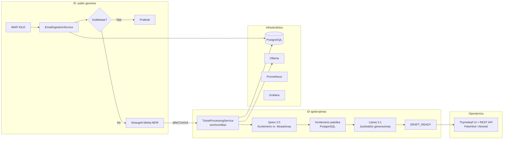

---

## Skyrius 2 — Kas jau padaryta v1 (1–3 savaitės)

### Technologijų rinkinys

- Java 17, **Spring Boot 4.0.5**, Spring Data JPA, Flyway
- PostgreSQL (schema: `V1__init.sql`, sėklos: `V2..V4`)
- Spring Integration IMAP IDLE (`ImapConfig`, `EmailIngestionService`)
- Ollama HTTP: Qwen 2.5 (ištraukimas), Llama 3.1 (juodraštis) — `WebClientConfig`
- Spring Security + JWT (`JwtService`, `JwtAuthenticationFilter`, `SecurityConfig`), httpOnly slapukas UI, `Authorization` antraštė REST
- **Sinchroninis** apdorojimas: `TicketProcessingService.process()` vykdomas tame pačiame IMAP gijoje per `TransactionSynchronization.afterCommit()`
- `RetryScheduler` — pakartotinis `RETRY_LATER` bilietų apdorojimas (po operatoriaus atmetimo)
- Thymeleaf UI (`login.html`, `tickets.html`, `ticket-detail.html`) + Bootstrap 5
- REST API: `AuthController`, `TicketController` (`/api/tickets` list/get/approve/reject), `AdminController` (`/admin/reprocess`, tik localhost)
- `OllamaHealthIndicator`, Actuator, Prometheus, Grafana (Docker Compose)
- Testcontainers + bazinis testas: `TicketProcessingServiceTest`

### Paketų struktūra (v1)

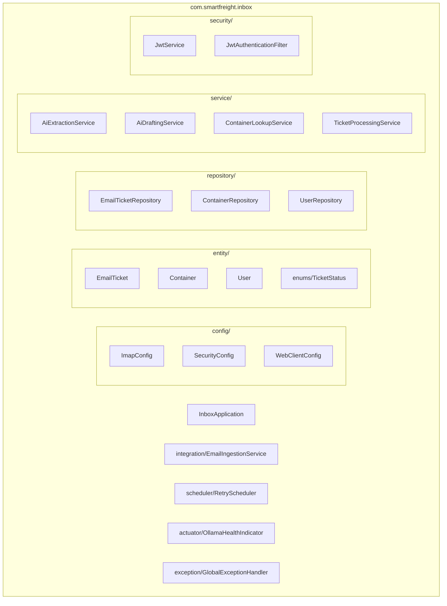

### Bilieto būsenų diagrama

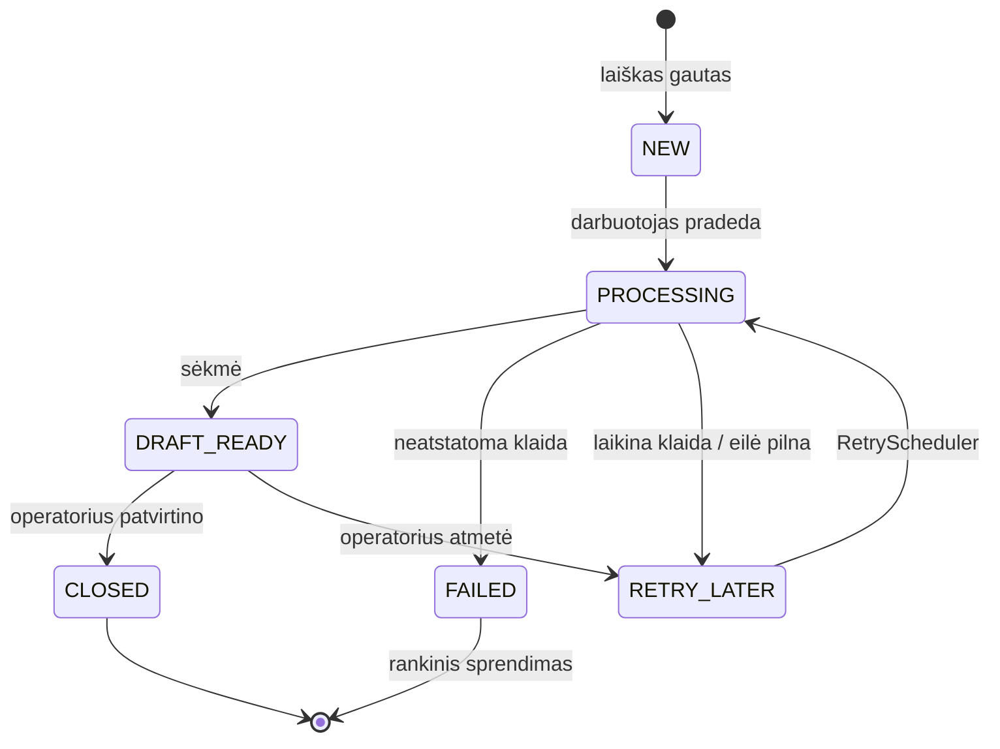

### Demo vartotojas

- El. paštas: `operator@smartfreight.com`
- Slaptažodis: `demo123` (saugomas kaip BCrypt maiša)

---

## Skyrius 3 — Likę v1 žingsniai (3–4 savaitės)

### Savaičių planas

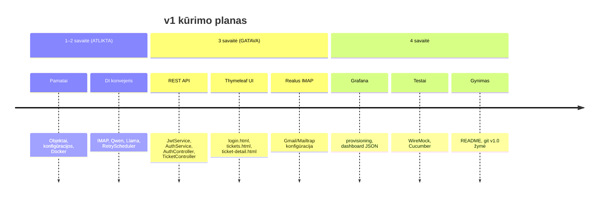

---

### 3 savaitė — REST API (5 žingsniai, 5 failai)

---

#### 1 žingsnis — `JwtService.java` — pridėti `generateToken()`

**Failas:** `src/main/java/com/smartfreight/inbox/security/JwtService.java`
**Tipas:** esamo failo redagavimas (tik papildymas)
**Ką daryti:** pridėti viešą JWT žetono generavimo metodą.

```java
public String generateToken(String email) {
    Date now = new Date();
    Date expiry = new Date(now.getTime() + JWT_EXPIRATION);
    return Jwts.builder()
            .subject(email)
            .issuedAt(now)
            .expiration(expiry)
            .signWith(getSigningKey())
            .compact();
}
```

**Svarbu:** naudoti jjwt 0.12.x API (`Jwts.builder()`, `.subject()`, `.expiration()`).
**Lūžimo rizika:** nėra — esami metodai nekeičiami.

---

#### 2 žingsnis — `TicketStatus.java` — pridėti `CLOSED`

**Failas:** `src/main/java/com/smartfreight/inbox/entity/enums/TicketStatus.java`
**Tipas:** esamo enum redagavimas (tik papildymas)
**Ką daryti:** pridėti naują reikšmę `CLOSED` enum pabaigoje.

```java
CLOSED  // operatorius patvirtino juodraštį ir uždarė bilietą
```

**Lūžimo rizika:** nėra — kode nėra switch sakinių be default.

---

#### 3 žingsnis — `AuthService.java` — naujas failas

**Failas:** `src/main/java/com/smartfreight/inbox/service/AuthService.java`
**Tipas:** naujas failas
**Ką daro:** priima el. paštą + slaptažodį, tikrina DB, grąžina JWT žetoną.

Logika:
1. `userRepository.findByEmail(email)` — rasti vartotoją
2. `passwordEncoder.matches(rawPassword, user.getPassword())` — patikrinti slaptažodį
3. `jwtService.generateToken(email)` — sukurti žetoną
4. Jei vartotojas nerastas arba slaptažodis neteisingas → mesti `ResponseStatusException(401)`

**Priklausomybės:** `UserRepository`, `PasswordEncoder` (bean iš `SecurityConfig`), `JwtService`

---

#### 4 žingsnis — `AuthController.java` — naujas failas

**Failas:** `src/main/java/com/smartfreight/inbox/controller/AuthController.java`
**Tipas:** naujas failas
**Galinis taškas:** `POST /api/auth/login`

```
Užklausa:  { "email": "operator@smartfreight.com", "password": "demo123" }
Atsakymas: { "token": "eyJhbGci..." }
HTTP 200 OK  /  HTTP 401 jei neteisingi duomenys
```

`SecurityConfig` jau leidžia `/api/auth/**` be JWT — nieko keisti nereikia.

---

#### 5 žingsnis — `TicketController.java` — naujas failas

**Failas:** `src/main/java/com/smartfreight/inbox/controller/TicketController.java`
**Tipas:** naujas failas
**Visi galutiniai taškai reikalauja JWT** (pagal numatytuosius nustatymus per `SecurityConfig`)

| Metodas | URL | Aprašymas | Atsakymas |
|---------|-----|-----------|-----------|
| `GET` | `/api/tickets` | Bilietų sąrašas (filtras `?status=DRAFT_READY`) | `List<EmailTicket>` |
| `GET` | `/api/tickets/{id}` | Vienas bilietas su juodraščiu | `EmailTicket` |
| `POST` | `/api/tickets/{id}/approve` | Patvirtinti juodraštį | `{status: "CLOSED"}` |
| `POST` | `/api/tickets/{id}/reject` | Atmesti / paleisti iš naujo | `{status: "RETRY_LATER"}` |

**Priklausomybės:** `EmailTicketRepository`

---

### REST API autentifikacijos srautas

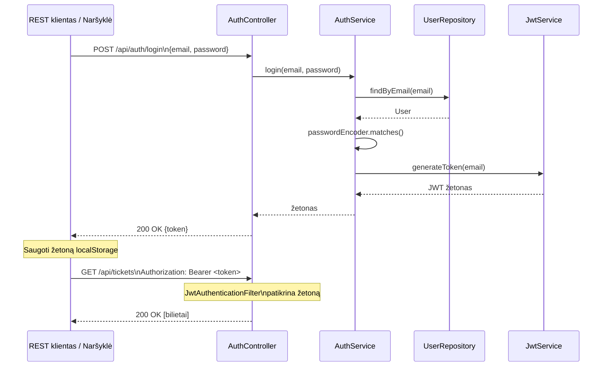

---

### 3 savaitė — UI (vietoj Angular pasirinktas Thymeleaf) ✅

**Sprendimas:** demo buvo pasirinktas **Thymeleaf + Bootstrap 5** — paprasčiau, nereikia atskiros JS-projekto kompiliacijos.
Šablonai: `src/main/resources/templates/` (`login.html`, `tickets.html`, `ticket-detail.html`).
Kontroleris: `TicketViewController` (JWT saugomas httpOnly slapuke).

6–13 žingsniai (Angular scaffold, AuthService, AuthGuard, TicketListComponent ir pan.) **atšaukti**.
Jei ateityje prireiks Angular — žr. senąją šio failo versiją git istorijoje.

---

### 4 savaitė — Grafana provisioning (4 žingsniai, atviras)

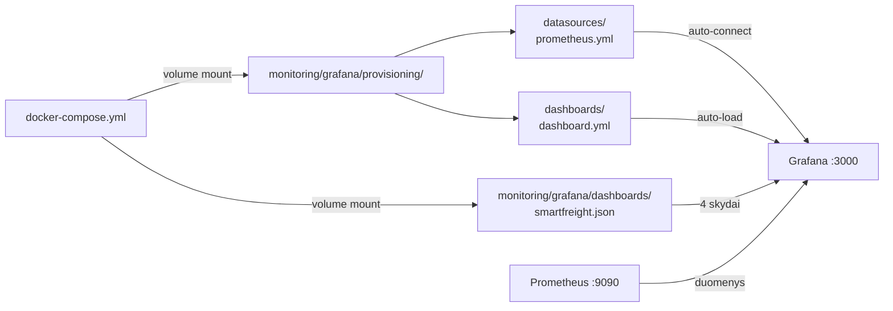

---

#### 14 žingsnis — Duomenų šaltinio provisioning

**Failas:** `monitoring/grafana/provisioning/datasources/prometheus.yml`

Automatiškai prijungia Prometheus kaip duomenų šaltinį paleidžiant Grafana.

---

#### 15 žingsnis — Dashboard provisioning konfigūracija

**Failas:** `monitoring/grafana/provisioning/dashboards/dashboard.yml`

Nurodo Grafana įkelti JSON skydelius iš aplanko `/var/lib/grafana/dashboards`.

---

#### 16 žingsnis — Dashboard JSON

**Failas:** `monitoring/grafana/dashboards/smartfreight.json`

4 skydai:
1. **Bilietai pagal būseną** — skritulinė diagrama `email_ticket` pagal būsenas
2. **Apdorojimo trukmė** — vidutinis laikas `NEW → DRAFT_READY`
3. **Pakartojimų skaičius** — bilietų `RETRY_LATER` kiekis
4. **Ollama sveikata** — `/actuator/health` komponento `ollama` būsena

---

#### 17 žingsnis — Atnaujinti `docker-compose.yml`

**Failas:** `docker-compose.yml`
**Tipas:** tik volume mount pridėjimas prie esamo `grafana` serviso

```yaml
grafana:
  volumes:
    - grafana_data:/var/lib/grafana
    - ./monitoring/grafana/provisioning:/etc/grafana/provisioning:ro   # pridėti
    - ./monitoring/grafana/dashboards:/var/lib/grafana/dashboards:ro   # pridėti
```

---

### 4 savaitė — Testai (7 žingsniai)

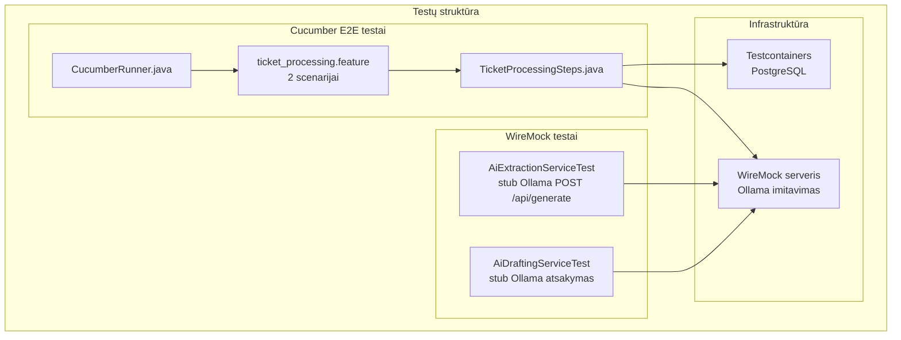

---

#### 18 žingsnis — WireMock priklausomybė `pom.xml`

**Failas:** `pom.xml`
**Svarbu:** prieš pridedant patikrinti suderinamumą su Spring Boot 4.0.5.
Naudoti `wiremock-spring-boot` iš Maciejwalkowiak arba `org.wiremock:wiremock` tiesiogiai.

---

#### 19 žingsnis — `AiExtractionServiceTest.java`

**Failas:** `src/test/java/com/smartfreight/inbox/service/AiExtractionServiceTest.java`

Testavimo atvejai:
- Ollama grąžina teisingą numerį → patikrinti, kad metodas jį grąžino
- Ollama grąžina „šiukšles" → regex atsarginė kopija rado numerį tekste
- Ollama nepasiekiamas (500) → regex atsarginė kopija suveikė
- Laiško turinys tuščias → grąžinti `""`

---

#### 20 žingsnis — `AiDraftingServiceTest.java`

**Failas:** `src/test/java/com/smartfreight/inbox/service/AiDraftingServiceTest.java`

Testavimo atvejai:
- Ollama grąžina juodraštį → patikrinti, kad tekstas išsaugotas
- Ollama nepasiekiamas → atsarginis juodraštis (statinis tekstas)
- Konteineris nerastas → juodraštis turi pranešimą apie trūkstamus duomenis

---

#### 21 žingsnis — Cucumber priklausomybės `pom.xml`

```xml
cucumber-java
cucumber-spring
cucumber-junit-platform-engine
```

**Svarbu:** naudoti versiją, suderinamą su JUnit 5 ir Spring Boot 4.0.5.

---

#### 22 žingsnis — `ticket_processing.feature`

**Failas:** `src/test/resources/features/ticket_processing.feature`

```gherkin
Feature: Bilieto apdorojimo konvejeris

  Scenario: Laiškas gautas ir sėkmingai apdorotas
    Given gautas naujas laiškas su konteinerio numeriu MSCU1234567
    When DI konvejeris apdoroja bilietą
    Then bilieto būsena turi būti DRAFT_READY
    And atsakymo juodraštis neturi būti tuščias

  Scenario: Ollama nepasiekiamas, naudojama atsarginė kopija
    Given gautas naujas laiškas su konteinerio numeriu MSCU1234567
    And Ollama paslauga nepasiekiama
    When DI konvejeris apdoroja bilietą
    Then bilieto būsena turi būti DRAFT_READY
    And atsakymo juodraštis turi turėti atsarginį tekstą
```

---

#### 23 žingsnis — `TicketProcessingSteps.java`

**Failas:** `src/test/java/com/smartfreight/inbox/cucumber/TicketProcessingSteps.java`

Žingsnių apibrėžimai kiekvienam `.feature` failo žingsniui.
Naudoja `@SpringBootTest` + Testcontainers PostgreSQL + WireMock Ollama imitavimui.

---

#### 24 žingsnis — `CucumberRunner.java`

**Failas:** `src/test/java/com/smartfreight/inbox/cucumber/CucumberRunner.java`

JUnit 5 paleidėjas Cucumber testams vykdyti per Maven (`mvn test`).

---

### 4 savaitė — Finalas (2 žingsniai)

---

#### 25 žingsnis — `README.md`

**Failas:** `README.md` projekto šaknyje

Turinys:
- Projekto aprašymas (1 pastraipa)
- Išankstiniai reikalavimai: Docker, Java 17 (Thymeleaf UI — be atskiro Node.js)
- Paleidimas: `docker compose up --build`
- Pirmas prisijungimas: `operator@smartfreight.com` / `demo123`
- API: pagrindiniai curl pavyzdžiai (prisijungimas, bilietų sąrašas, patvirtinimas)
- UI: Thymeleaf šablonai aptarnaujami to paties `:8080` (atskiro frontendo nereikia)
- Nuorodos: Grafana (`:3000`), Prometheus (`:9090`), Actuator (`:8080/actuator/health`)

---

#### 26 žingsnis — Git žymė v1.0 ir galutinis push

```bash
git add .
git commit -m "feat: complete v1 MVP"
git tag v1.0
git push origin main --tags
```

Saugykla: `https://github.com/olegskel7-wq/smart-freight-inbox`

---

## Skyrius 4 — v2 planas (7 fazės)

> v2 įgyvendinamas **po** v1 užbaigimo ir gynimo.
> Visas v2 kodas — pakete `com.smartfreight.inbox.v2`.
> **Spring Boot versija: 4.0.5** (ne 3.x — tikrinti priklausomybių suderinamumą).

### v1 → v2 evoliucija

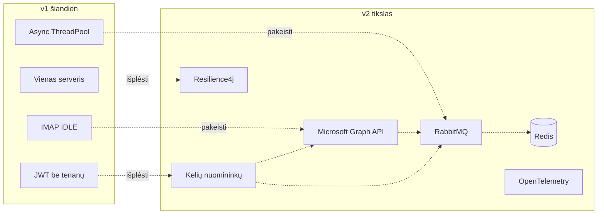

---

### v2 technologijų rinkinys

| Komponentas | Technologija |
|-------------|--------------|
| El. pašto gavimas | Microsoft Graph API (webhooks + delta) |
| Pranešimų tarpininkas | **RabbitMQ** (ne Kafka) |
| Talpykla / užraktai | Redis |
| Kelių nuomininkų | `tenant_id` lentelėse, JWT reikalavimai |
| Atsparumas | Resilience4j (circuit breaker, retry, bulkhead) |
| Sekimas | OpenTelemetry |
| Frontend | Angular 17 (kelių nuomininkų, vaidmenimis pagrįstas) |
| DevOps | Docker Compose → Kubernetes (pasirinktinai) |

### v2 modulių struktūra

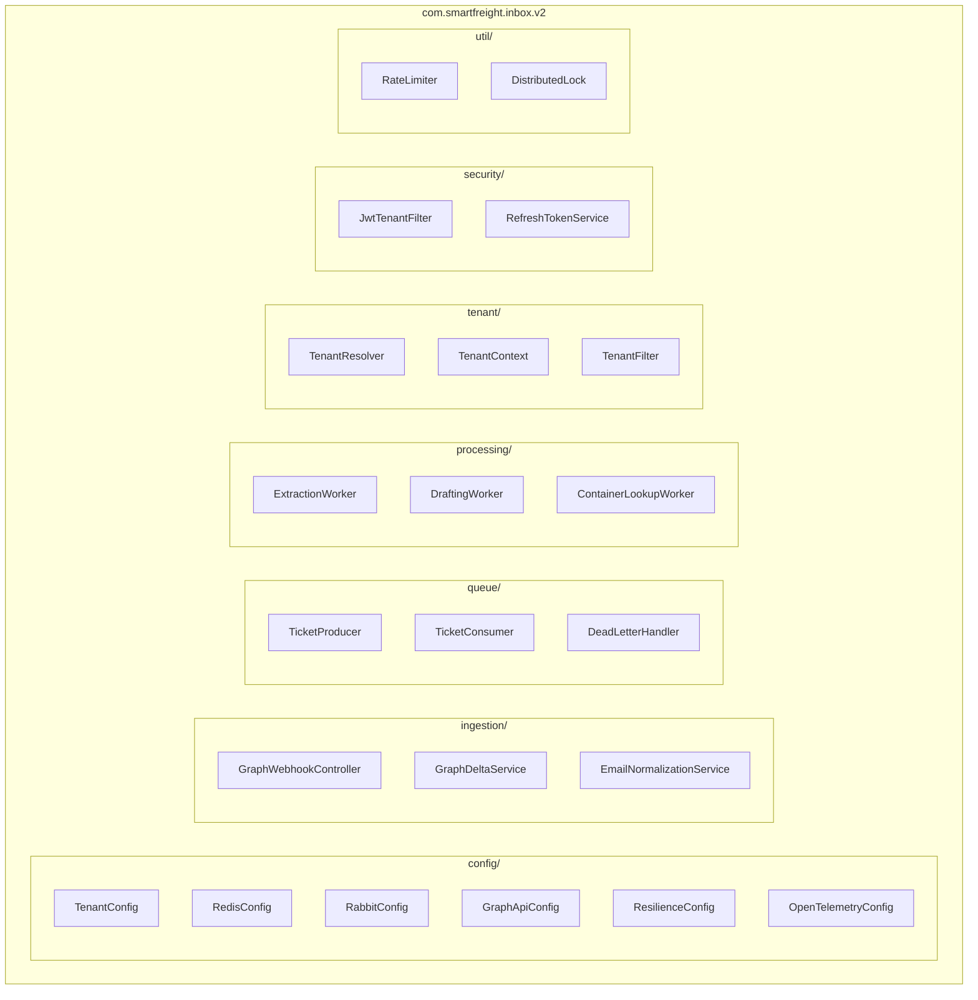

---

### Fazė 1 — Pranešimų eilė (RabbitMQ)

**Tikslas:** pakeisti sinchroninį `process()` RabbitMQ eile su garantuotu pristatymu.

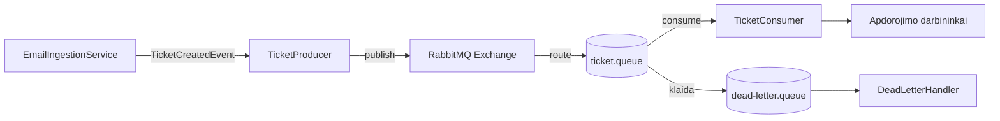

Failai:
- `RabbitConfig.java` — exchange, queue, bindings, DLQ konfigūracija
- `TicketProducer.java` — publikuoja `TicketCreatedEvent` į eilę
- `TicketConsumer.java` — klauso eilę, paleidžia apdorojimą
- `DeadLetterHandler.java` — apdoroja pranešimus iš dead-letter eilės

Pridėti `docker-compose.yml`: servisas `rabbitmq:3-management`.

---

### Fazė 2 — Microsoft Graph API

**Tikslas:** pakeisti IMAP IDLE su webhooks + delta sinchronizacija.

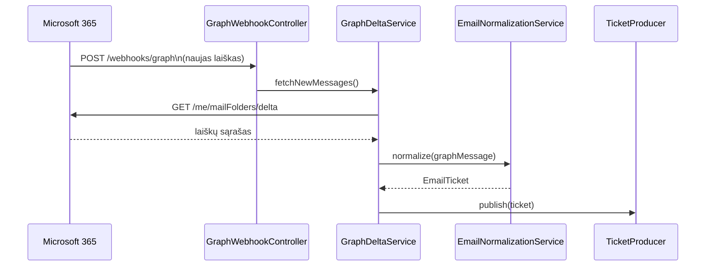

Failai:
- `GraphApiConfig.java` — MSAL (Microsoft Authentication Library) konfigūracija
- `GraphWebhookController.java` — priima Graph pranešimus
- `GraphDeltaService.java` — užklausia naujus laiškus per delta query
- `EmailNormalizationService.java` — normalizuoja Graph pranešimą į `EmailTicket` formatą

---

### Fazė 3 — Redis

**Tikslas:** konteinerių talpykla, greičio ribojimas, paskirstyti užraktai, refresh žetonai.

Failai:
- `RedisConfig.java` — prisijungimas, serializacijos konfigūracija
- `DistributedLock.java` — Lua scenarijus per `RedisTemplate` (vieno bilieto neapdoroti du kartus)
- `RateLimiter.java` — Ollama užklausų apribojimas
- `RefreshTokenService.java` (in `security/`) — refresh žetono saugojimas Redis su TTL

Pridėti `docker-compose.yml`: servisas `redis:7-alpine`.

---

### Fazė 4 — Kelių nuomininkų architektūra

**Tikslas:** atskirti skirtingų nuomininkų duomenis DB ir JWT lygyje.

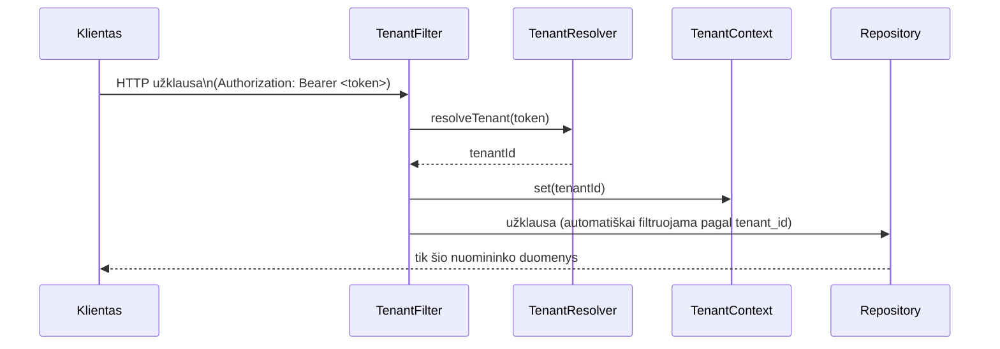

Failai:
- `TenantContext.java` — `ThreadLocal<String> tenantId`
- `TenantResolver.java` — ištraukia `tenantId` iš JWT reikalavimo
- `TenantFilter.java` — Servlet filtras, nustato `TenantContext` kiekvienai užklausai

DB pakeitimai: pridėti `tenant_id` prie `email_ticket`, `container` lentelių (per Flyway migraciją).

---

### Fazė 5 — Resilience4j

**Tikslas:** padaryti Ollama skambučius atsparius gedimams.

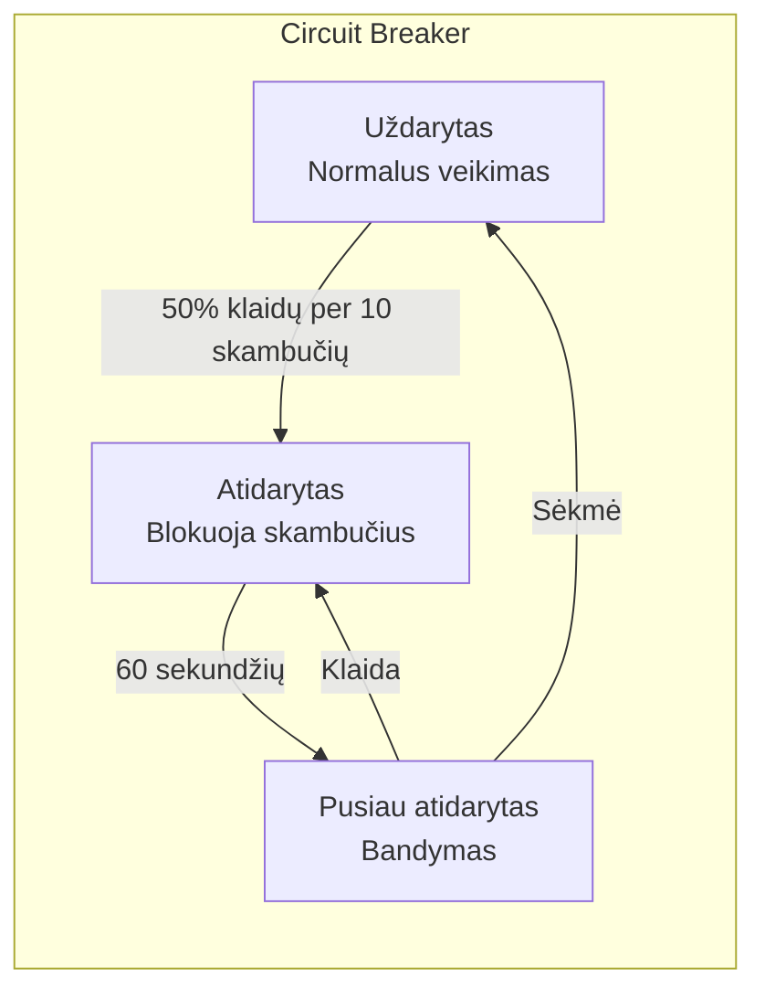

Failas: `ResilienceConfig.java`

Nustatymai:
- Circuit breaker: atidaryti esant 50% klaidų per 10 skambučių
- Retry: 3 bandymai su backoff 2s → 4s → 8s
- Bulkhead: ne daugiau 4 lygiagrečių skambučių į Ollama

Apvynioti: `AiExtractionService.extractContainerNumber()` ir `AiDraftingService.generateDraft()`.

---

### Fazė 6 — Stebėjimas (OpenTelemetry)

**Tikslas:** ištisinė sekimo grandinė nuo laiško gavimo iki operatoriaus atsakymo.

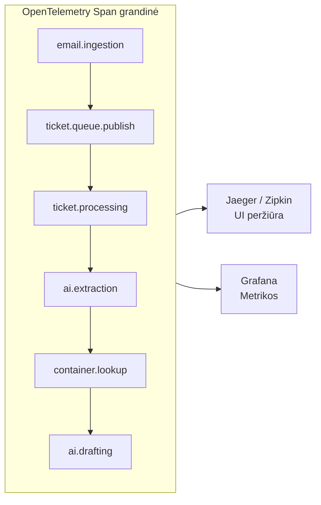

Failas: `OpenTelemetryConfig.java`

Pridėti `docker-compose.yml`: Jaeger arba Zipkin sekų peržiūrai.
Atnaujinti Grafana skydelį: pridėti OpenTelemetry duomenų skydelius.

---

### Fazė 7 — Angular v2 UI

**Tikslas:** kelių nuomininkų sąsaja su nuomininko perjungimu ir SLA skydeliais.

Komponentai (plečia v1 UI):
- `TenantSwitcherComponent` — aktyvaus nuomininko pasirinkimas
- `SlaOverviewComponent` — vidutinis apdorojimo laikas, % laiku
- `UserManagementComponent` — nuomininko vartotojų CRUD (ADMIN vaidmeniui)

Paslaugos:
- Atnaujinti `AuthService` — saugoti `tenantId` iš JWT
- Atnaujinti `AuthInterceptor` — pridėti `X-Tenant-Id` antraštę

---

## Skyrius 5 — Saugos taisyklės (agentams)

1. **Niekada nekeisti v1 paketų įgyvendinant v2** — visas v2 pakete `com.smartfreight.inbox.v2`
2. **Spring Boot versija: 4.0.5** — tikrinti bet kurios naujos priklausomybės suderinamumą
3. **Tarpininkas: RabbitMQ** — ne Kafka, ne ActiveMQ
4. **`TicketStatus` pakeitimai — tik papildymai** — naujų reikšmių pridėjimas tik enum pabaigoje
5. **Angular UI — atskiras aplankas** — ne viduje Spring Boot `src/`
6. **`docker-compose.yml` — tik papildymai** — nešalinti esamų servisų ir volumes
7. **Flyway migracijos — tik į priekį** — niekada neredaguoti esamų SQL failų
8. **Testai naudoja Testcontainers** — nejungti prie vietinės DB testuose

---

## Skyrius 6 — Nuoroda: prievadai ir servisai

| Servisas | URL | Prisijungimas |
|----------|-----|---------------|
| Spring Boot API | http://localhost:8080 | JWT žetonas |
| Thymeleaf UI | http://localhost:8080/login | operator@smartfreight.com / demo123 |
| PostgreSQL | localhost:5433 | postgres / postgres |
| Ollama | http://localhost:11434 | — |
| Prometheus | http://localhost:9090 | — |
| Grafana | http://localhost:3000 | admin / changeme |
| RabbitMQ UI (v2) | http://localhost:15672 | guest / guest |
| Redis (v2) | localhost:6379 | — |

---

## Skyrius 7 — Docker infrastruktūros schema

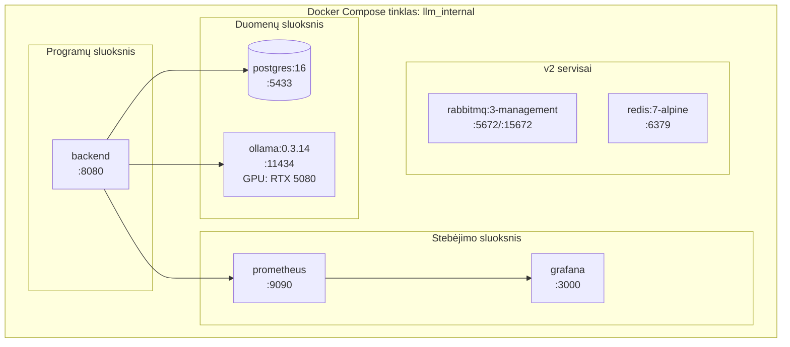

---

*Šis failas — gyvas dokumentas. Atnaujink žingsnių statusus vykdant.*
*Paskutinis atnaujinimas: 3 savaitė užbaigta. REST API + Thymeleaf UI + sinchroninis konvejeris + realus IMAP — repozitorijuje.*
*Originalus dokumentas rusų kalba: `docs/MASTER_ROADMAP.md`*
