# Smart Freight Inbox — Mermaid диаграммы

> Вставляй каждый блок на [mermaid.live](https://mermaid.live) или в GitHub/Notion.
> Каждая диаграмма — отдельный самодостаточный блок.

---

## 1. Полный поток системы (v1)

```mermaid
flowchart TB
  subgraph INGEST ["1 — Приём почты"]
    MS[(Почтовый\nсервер IMAP)]
    IDLE[IMAP IDLE\nSpring Integration]
    SVC[EmailIngestionService]
    DUP{Message-ID\nуже в БД?}
    MS --> IDLE --> SVC --> DUP
    DUP -->|да| SKIP[Пропустить]
    DUP -->|нет| SAVE[Сохранить EmailTicket\nstatus = NEW]
  end

  subgraph PROC ["2 — AI обработка (async)"]
    TPS[TicketProcessingService\n@Async llmTaskExecutor]
    ST1[Статус → PROCESSING]
    QW[Qwen 2.5 / Ollama\nизвлечь номер контейнера]
    CL[Поиск контейнера\nPostgreSQL]
    LL[Llama 3.1 / Ollama\nгенерация черновика]
    ST2[Статус → DRAFT_READY]
    SAVE --> TPS --> ST1 --> QW --> CL --> LL --> ST2
  end

  subgraph DATA ["3 — Хранилище"]
    PG[(PostgreSQL\nEmailTicket, Container, User)]
    ST1 -.-> PG
    CL --> PG
    ST2 --> PG
    SAVE --> PG
  end

  subgraph OPS ["4 — Оператор"]
    UI[Angular UI\nПросмотр / Одобрить / Отклонить]
    ST2 --> UI
  end

  subgraph RES ["Устойчивость"]
    RL[RETRY_LATER\nRetryScheduler]
    FL[FAILED\nручная обработка]
    TPS -.-> RL
    TPS -.-> FL
  end
```

---

## 2. Машина состояний тикета

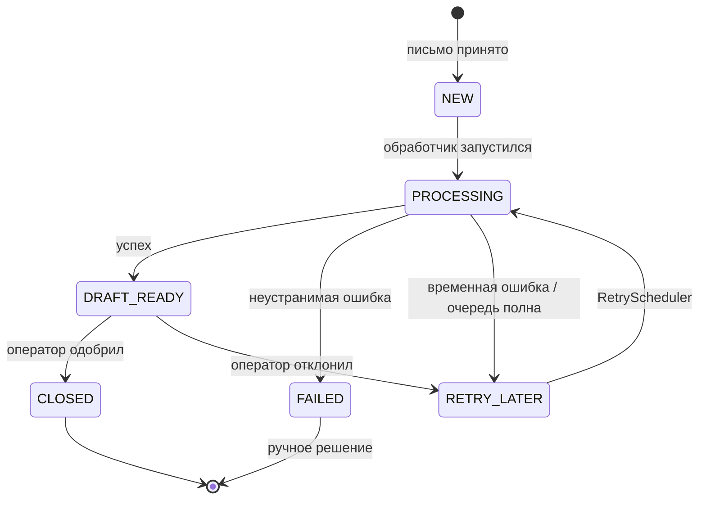

---

## 3. Слоёная архитектура v1

```mermaid
flowchart TB
  subgraph L4 ["Слой 4 — Потребители"]
    UI[Operator Angular UI]
  end
  subgraph L3 ["Слой 3 — API и безопасность"]
    AC[AuthController\nPOST /api/auth/login]
    TC[TicketController\nGET/POST /api/tickets]
    SEC[JWT Filter + SecurityConfig]
  end
  subgraph L2 ["Слой 2 — Домен и интеграции"]
    ING[EmailIngestionService\nIMAP IDLE]
    TPS[TicketProcessingService\n@Async]
    AI[AiExtractionService\nAiDraftingService]
  end
  subgraph L1 ["Слой 1 — Данные и инфраструктура"]
    PG[(PostgreSQL)]
    OL[Ollama\nQwen + Llama]
    DC[Docker Compose]
    MON[Prometheus / Grafana]
  end

  UI --> AC
  UI --> TC
  AC --> SEC
  TC --> SEC
  SEC --> ING
  SEC --> TPS
  ING --> PG
  TPS --> PG
  TPS --> AI
  AI --> OL
  PG --> DC
  OL --> DC
  MON --> DC
```

---

## 4. Структура пакетов v1 (treemap)

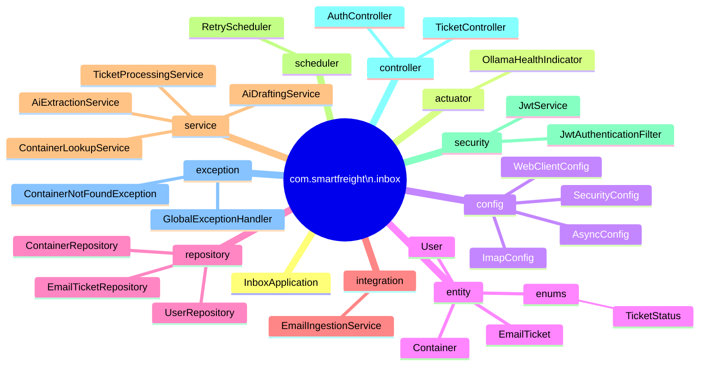

---

## 5. Последовательность аутентификации

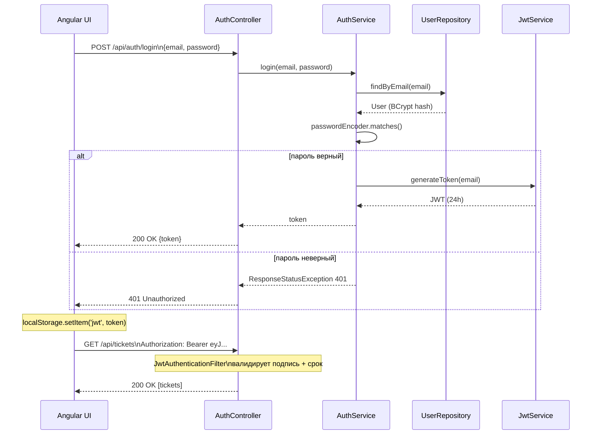

---

## 6. Навигация Angular UI

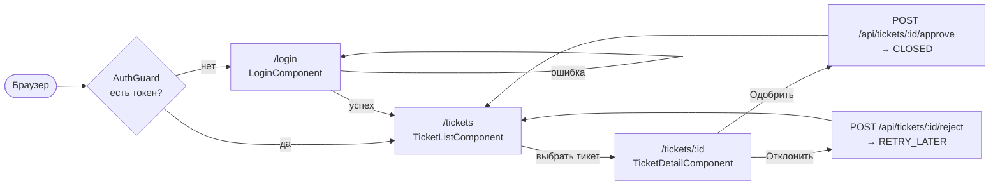

---

## 7. Docker Compose инфраструктура

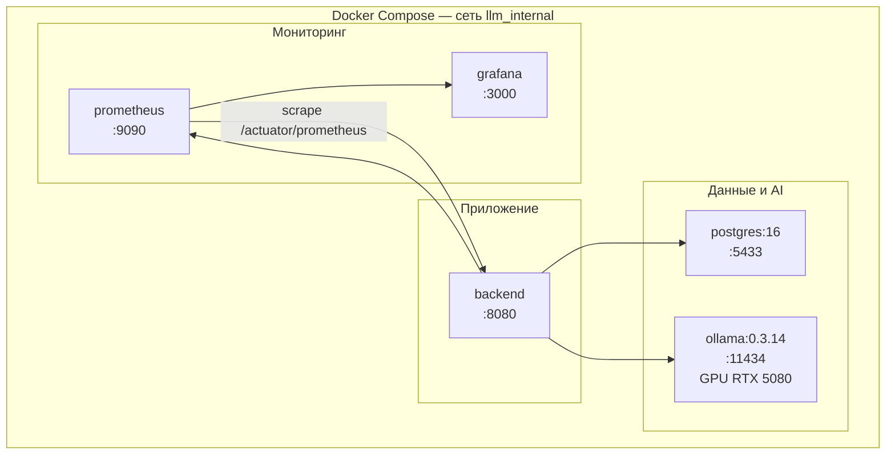

---

## 8. Grafana provisioning

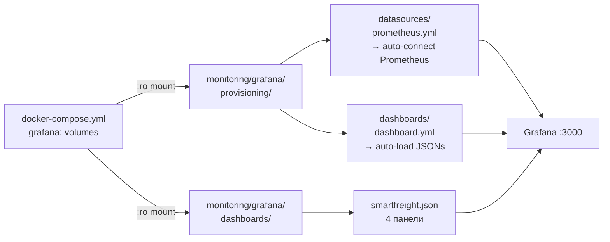

---

## 9. Дорожная карта v1 (временная шкала)

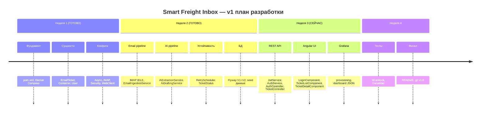

---

## 10. v1 → v2 эволюция

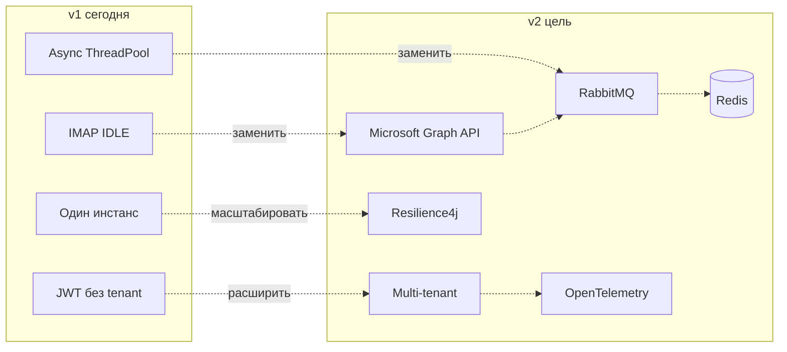

---

## 11. Структура пакетов v2 (treemap)

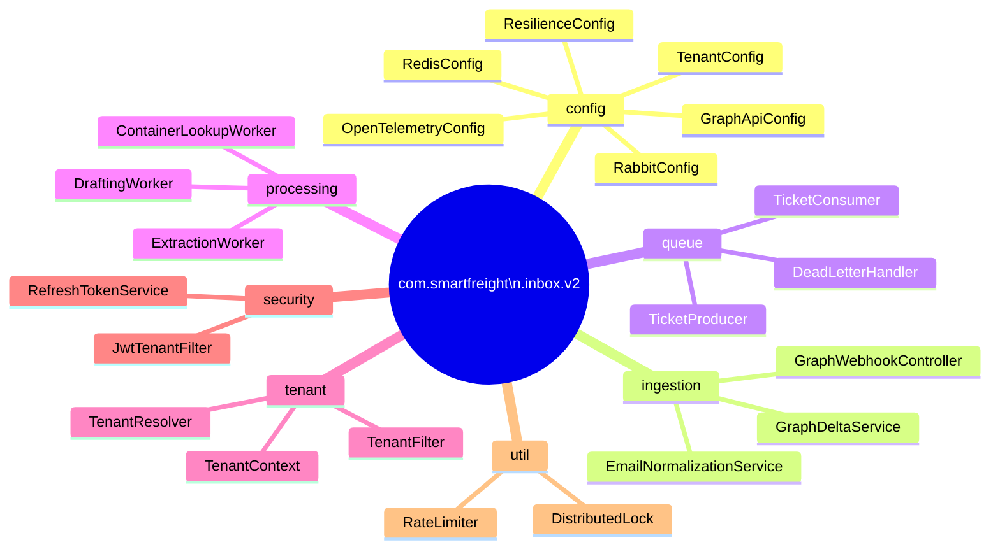

---

## 12. v2 архитектура — полный поток

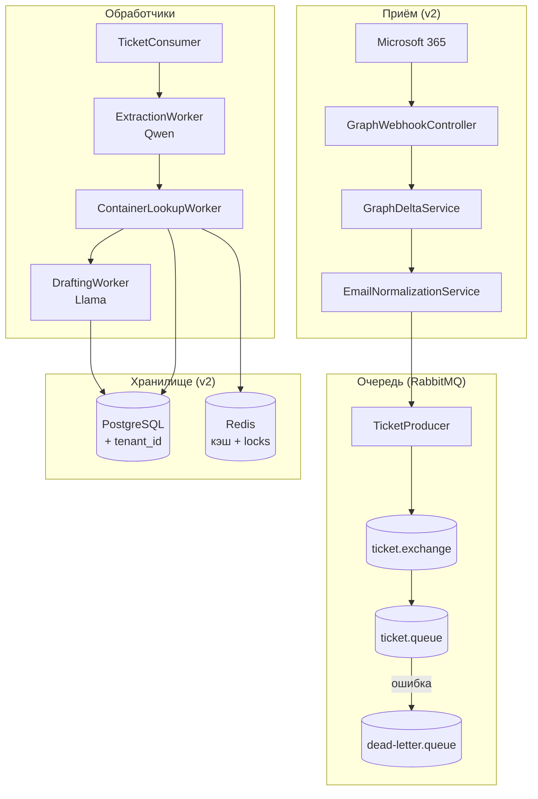

---

## 13. RabbitMQ поток

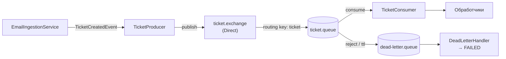

---

## 14. Circuit Breaker (Resilience4j)

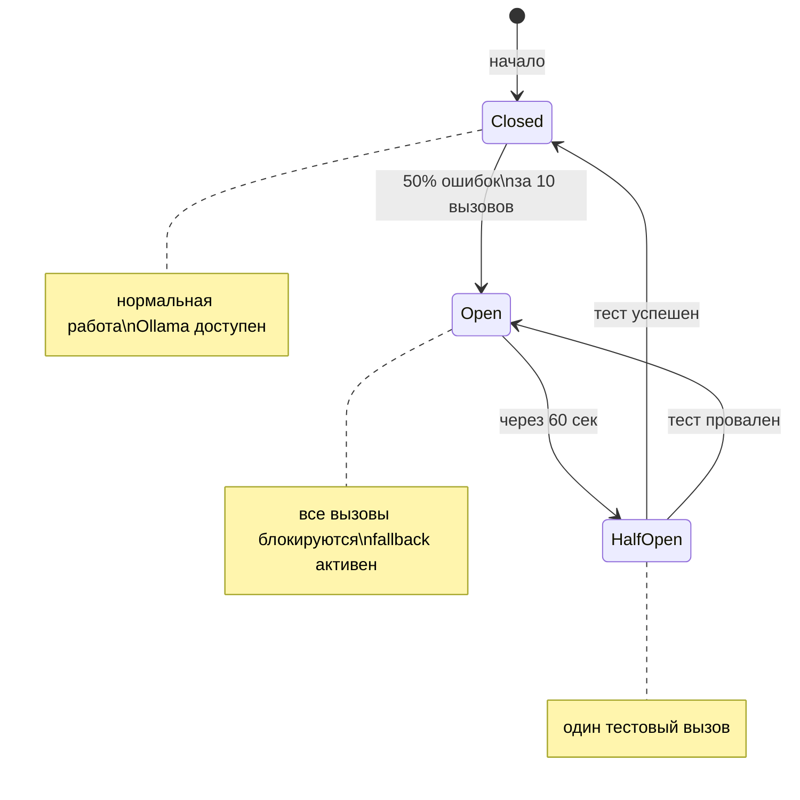

---

## 15. OpenTelemetry трассировка (v2)

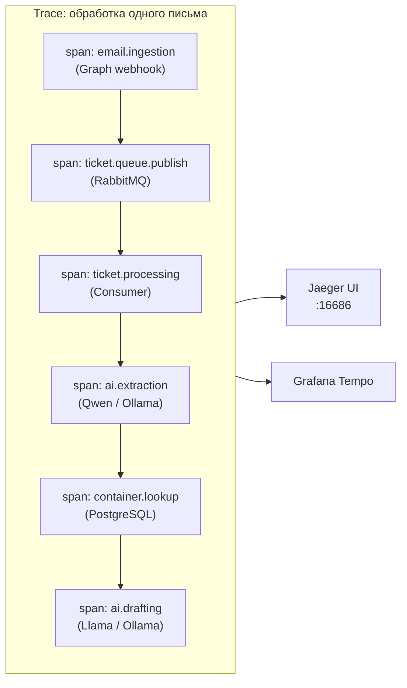

---

## 16. Структура файлов проекта (полное дерево)

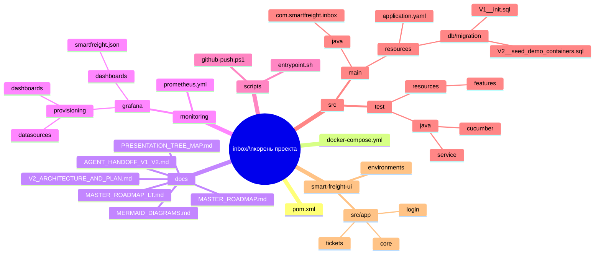

---

*Все диаграммы работают на [mermaid.live](https://mermaid.live), в GitHub README, Notion и Obsidian.*
*Файл: `docs/MERMAID_DIAGRAMS.md`*
