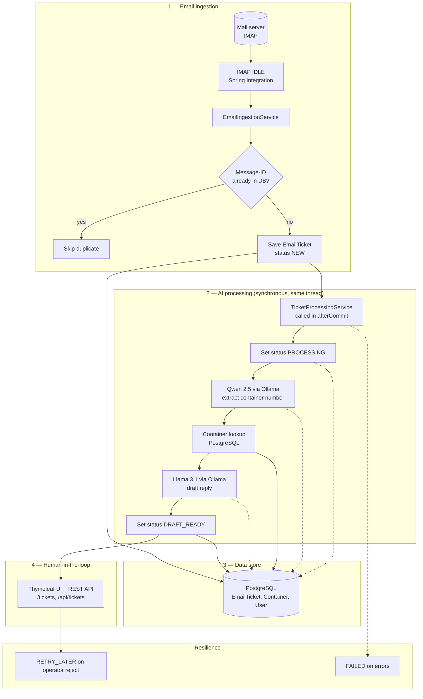
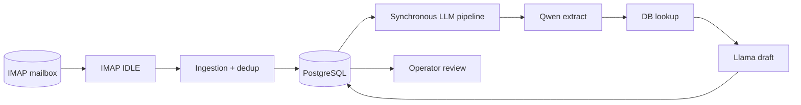
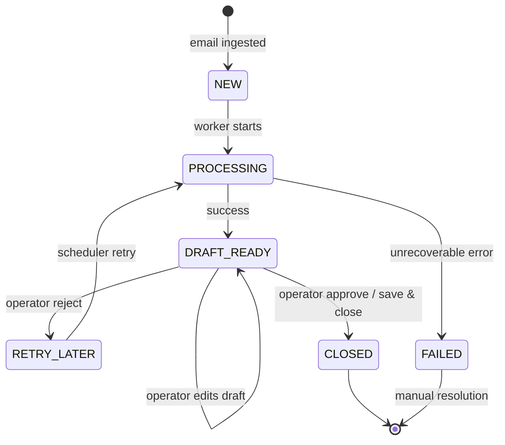
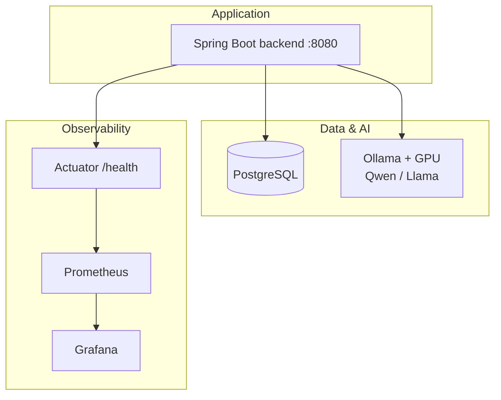
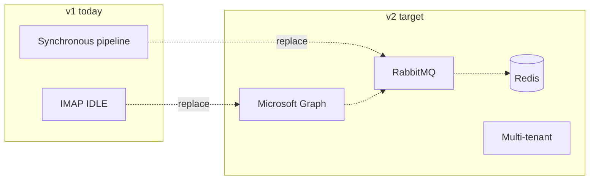
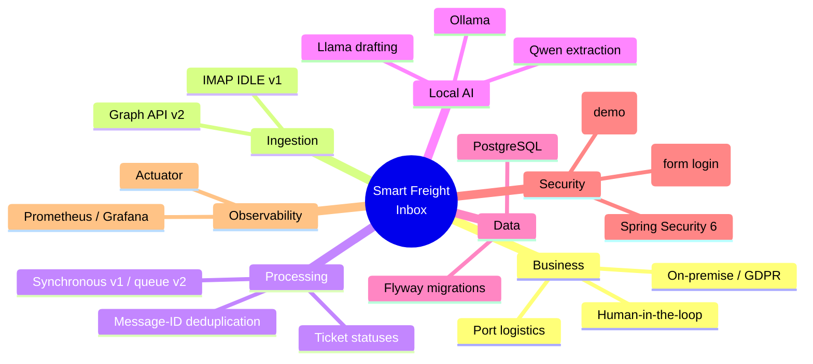
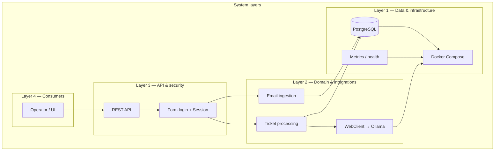
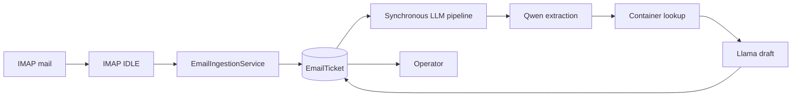
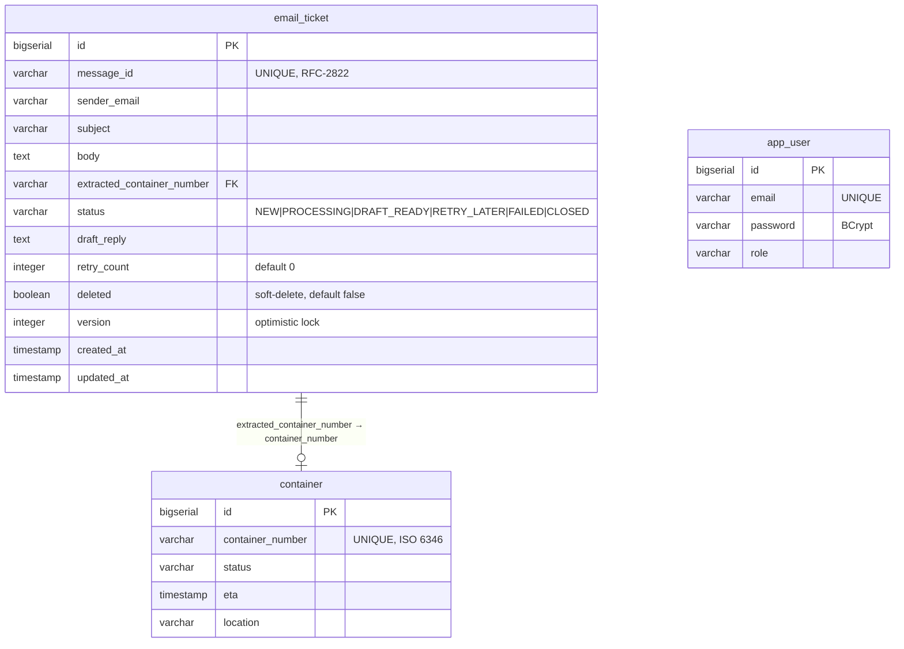
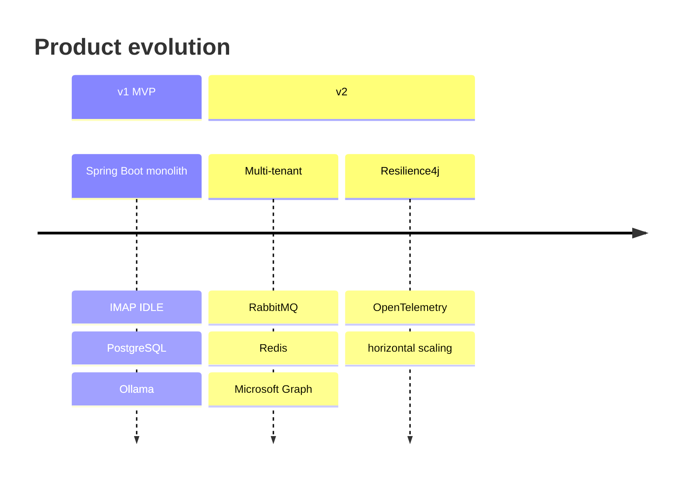

# Smart Freight Inbox — presentation map & diagrams

**How to use:** copy **Mermaid** blocks into [mermaid.live](https://mermaid.live), Marp, Notion, or GitHub.  
For PowerPoint: export PNG/SVG from mermaid.live.

You can add a university logo and a “risks / metrics” slide next to the Observability block for your committee.

---

## 1. Flow diagrams (recommended for slides)

### A. End-to-end pipeline (v1 MVP)

Mail intake, persistence, synchronous LLM processing (after commit), operator handoff.



### B. Simplified linear flow (single slide)



### C. EmailTicket state machine



### D. Runtime & observability (Docker stack)



### E. Planned v2 delta (context slide)



---

## 2. Mindmap (v1 + path to v2)



---

## 3. Layered architecture (nested view)

*Not a data treemap by area; this is a **layer hierarchy** for an “architecture” slide.*



---

## 4. Data pipeline (compact slide)



---

## 5. Java package tree (v1 repository)

```
smartfreight.inbox
├── InboxApplication
├── actuator
│   └── OllamaHealthIndicator
├── config
│   ├── ImapConfig           ← Spring Integration, mailChannel
│   ├── SecurityConfig       ← form login + InMemoryUserDetailsManager
│   └── WebClientConfig      ← Ollama timeouts, connection pool
├── controller
│   ├── AuthController       ← POST /api/auth/login
│   ├── TicketController     ← REST /api/tickets (list/get/approve/reject)
│   ├── TicketViewController ← Thymeleaf UI
│   └── AdminController      ← POST /admin/reprocess (localhost only)
├── entity
│   ├── EmailTicket
│   ├── Container
│   ├── User
│   └── enums / TicketStatus
├── repository
│   ├── EmailTicketRepository
│   ├── ContainerRepository
│   └── UserRepository
├── integration
│   └── EmailIngestionService  ← schedules process() via afterCommit
├── service
│   ├── AuthService
│   ├── AiExtractionService
│   ├── AiDraftingService
│   ├── ContainerLookupService
│   └── TicketProcessingService  ← synchronous
├── scheduler
│   └── RetryScheduler
└── exception
    ├── GlobalExceptionHandler
    └── ContainerNotFoundException
```

---

## 6. Database schema (ER diagram)

Three tables, created by Flyway V1. `email_ticket` is the core entity; `container` is the reference catalogue; `app_user` holds operator credentials.



### Flyway migration history

| Version | File | Purpose |
|---------|------|---------|
| V1 | `V1__init.sql` | Create all tables + indexes |
| V2 | `V2__seed_demo_containers.sql` | Seed test containers (OOLU, MSCU…) |
| V3 | `V3__fix_demo_user_password.sql` | Fix BCrypt hash for demo operator |
| V4 | `V4__seed_test_tickets.sql` | Seed sample tickets for demo |

### Indexes

| Index | Table | Column | Condition |
|-------|-------|--------|-----------|
| `idx_email_ticket_message_id` | email_ticket | message_id | — |
| `idx_email_ticket_status` | email_ticket | status | `WHERE deleted = false` |
| `idx_container_number` | container | container_number | — |

---

## 7. Repository root (top-level files)

```
inbox/
├── pom.xml
├── docker-compose.yml       ← backend, postgres, ollama, prometheus, grafana
├── README.md
├── docs/                    ← project documentation (this file et al.)
├── monitoring/
│   └── prometheus.yml
├── scripts/
│   ├── entrypoint.sh
│   ├── github-push.ps1
│   └── verify-imap-ready.ps1
└── src/main/
    ├── java/.../com/smartfreight/inbox/...
    └── resources/
        ├── application.yaml
        ├── templates/       ← Thymeleaf (login, tickets, ticket-detail)
        └── db/migration/    ← V1..V4
```

---

## 8. Roadmap v1 → v2 (timeline slide)



---

*Extend with committee-specific slides (demo, risks, test strategy) as needed.*
