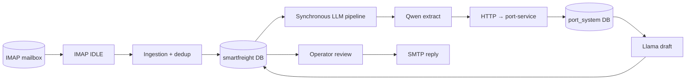
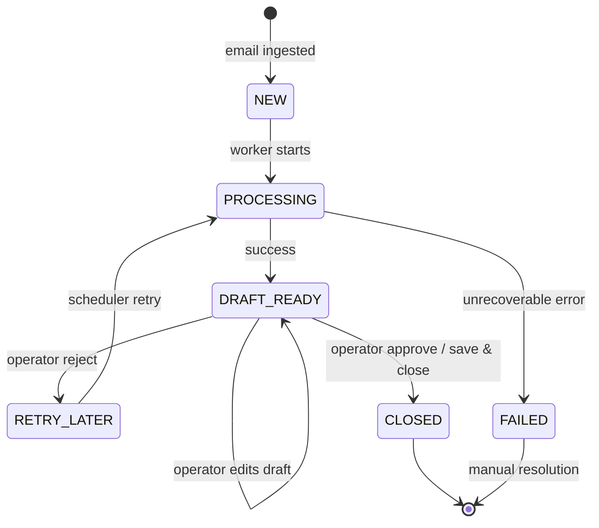
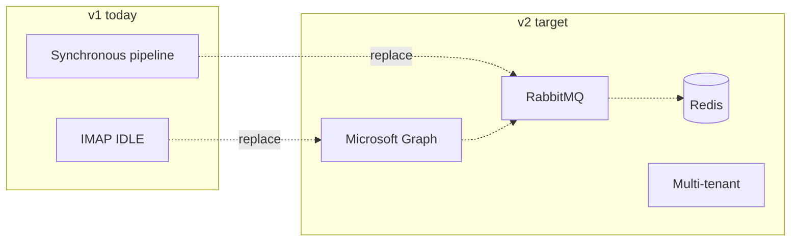
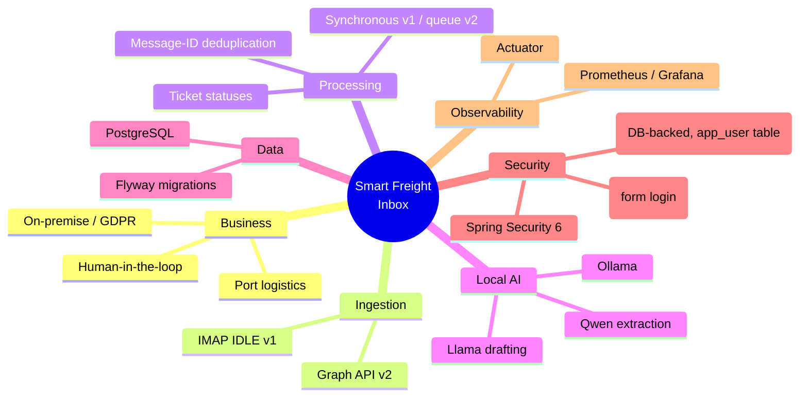
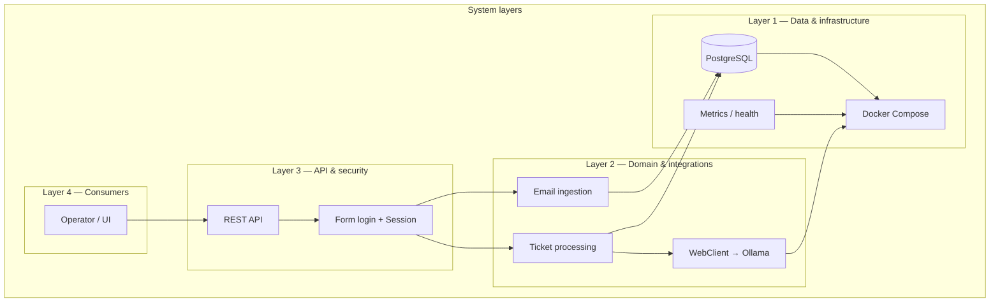
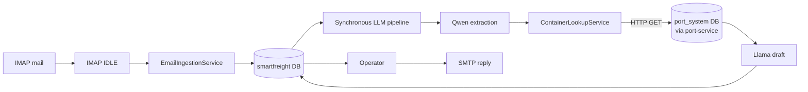
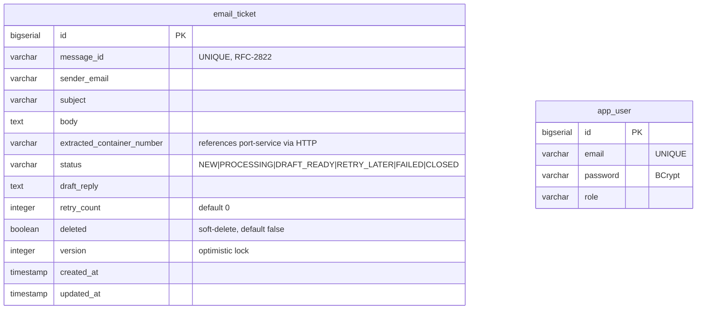
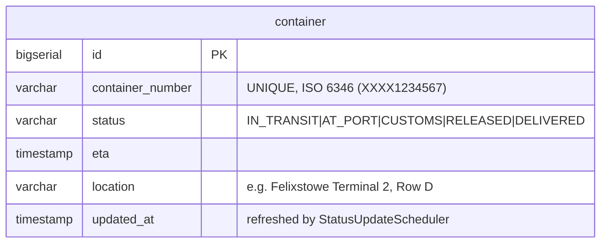
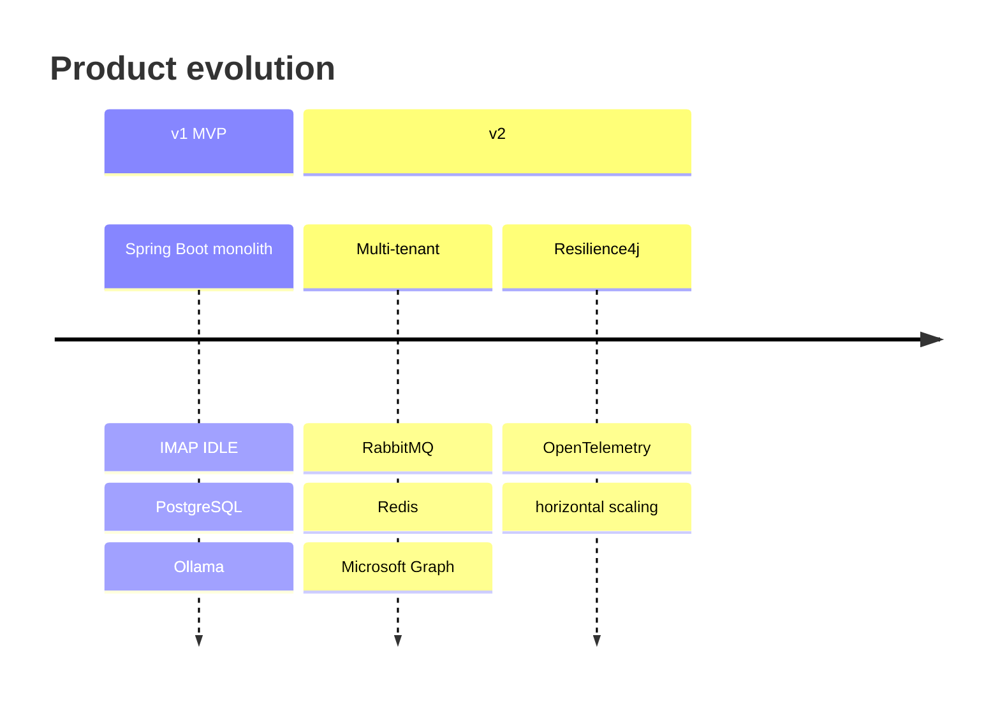

# Smart Freight Inbox — presentation map & diagrams

**How to use:** copy **Mermaid** blocks into [mermaid.live](https://mermaid.live), Marp, Notion, or GitHub.  
For PowerPoint: export PNG/SVG from mermaid.live.

You can add a university logo and a “risks / metrics” slide next to the Observability block for your committee.

---

## 1. Flow diagrams (recommended for slides)

### A. End-to-end pipeline (v1 MVP — two-service architecture)

Mail intake, persistence, synchronous LLM processing (after commit), operator handoff.  
Container data is fetched from **port-service** microservice via HTTP, not from inbox DB.

```mermaid
flowchart TB
  subgraph INGEST["1 — Email ingestion"]
    direction TB
    MS[(Mail server<br/>IMAP)]
    IDLE[IMAP IDLE<br/>Spring Integration]
    SVC[EmailIngestionService]
    DUP{Message-ID<br/>already in DB?}
    MS --> IDLE --> SVC --> DUP
    DUP -->|yes| SKIP[Skip duplicate]
    DUP -->|no| SAVE[Save EmailTicket<br/>status NEW]
  end

  subgraph PROC["2 — AI processing (synchronous, same thread)"]
    direction TB
    TPS[TicketProcessingService<br/>called in afterCommit]
    ST1[Set status PROCESSING]
    QW[Qwen 2.5 via Ollama<br/>extract container number]
    CL[ContainerLookupService<br/>HTTP GET → port-service]
    LL[Llama 3.1 via Ollama<br/>draft reply]
    ST2[Set status DRAFT_READY]
    SAVE --> TPS
    TPS --> ST1 --> QW --> CL --> LL --> ST2
  end

  subgraph PS["port-service :9000"]
    PSC[ContainerController<br/>GET /api/containers/{number}]
    PSDB[(port_system DB<br/>container table<br/>20 containers, 5 UK ports)]
    PSS[StatusUpdateScheduler<br/>every 5 min]
    PSC --> PSDB
    PSS --> PSDB
  end

  subgraph DATA["3 — inbox data store"]
    PG[(smartfreight DB<br/>EmailTicket, User)]
    ST1 -.-> PG
    QW -.-> PG
    LL -.-> PG
    ST2 --> PG
    SAVE --> PG
  end

  subgraph OPS["4 — Human-in-the-loop"]
    UI[Thymeleaf UI + REST API<br/>/tickets, /api/tickets]
    SMTP[EmailReplyService<br/>SMTP outgoing reply]
    ST2 --> UI
    UI --> SMTP
  end

  subgraph RES["Resilience"]
    RL[RETRY_LATER on operator reject]
    FL[FAILED on errors]
    TPS -.-> FL
    UI -.-> RL
  end

  CL -->|HTTP GET| PSC
```

### B. Simplified linear flow (single slide)



### C. EmailTicket state machine



### D. Runtime & observability (Docker stack)

```mermaid
flowchart TB
  subgraph APP["Applications"]
    SB[inbox :8080]
    PS[port-service :9000]
    SB -->|HTTP GET /api/containers/{n}| PS
  end
  subgraph DATA["Data & AI"]
    PG1[(smartfreight DB<br/>app_user, email_ticket)]
    PG2[(port_system DB<br/>container)]
    OL[Ollama + GPU<br/>Qwen 2.5 / Llama 3.1]
  end
  subgraph OBS["Observability"]
    PR[Prometheus]
    GF[Grafana]
    AC[Actuator /health<br/>/prometheus]
  end
  SB --> PG1
  PS --> PG2
  SB --> OL
  SB --> AC
  AC --> PR
  PR --> GF
```

### E. Planned v2 delta (context slide)



---

## 2. Mindmap (v1 + path to v2)



---

## 3. Layered architecture (nested view)

*Not a data treemap by area; this is a **layer hierarchy** for an “architecture” slide.*



---

## 4. Data pipeline (compact slide)



---

## 5. Java package tree (v1 repository)

### inbox (port 8080)

```
smartfreight.inbox
├── InboxApplication
├── actuator
│   └── OllamaHealthIndicator
├── config
│   ├── DbUserDetailsService ← UserDetailsService backed by app_user table (replaces InMemoryUserDetailsManager)
│   ├── ImapConfig           ← Spring Integration, mailChannel
│   ├── SecurityConfig       ← form login + AuthenticationManager bean (uses DbUserDetailsService)
│   ├── SmtpConfig           ← JavaMailSender for outgoing replies
│   └── WebClientConfig      ← Ollama + port-service WebClients
├── controller
│   ├── AuthController       ← POST /api/auth/login
│   ├── TicketController     ← REST /api/tickets (list/get/approve/reject/send)
│   ├── TicketViewController ← Thymeleaf UI (tickets, ticket-detail, login)
│   └── AdminController      ← POST /admin/reprocess (localhost only)
├── entity
│   ├── EmailTicket          ← @Entity → email_ticket table
│   ├── Container            ← plain POJO (no @Entity), deserialized from port-service HTTP response
│   ├── User                 ← @Entity → app_user table
│   └── enums / TicketStatus
├── repository
│   ├── EmailTicketRepository
│   └── UserRepository
├── integration
│   └── EmailIngestionService  ← IMAP IDLE, schedules process() via afterCommit
├── service
│   ├── AuthService
│   ├── AiExtractionService    ← Qwen 2.5 via Ollama
│   ├── AiDraftingService      ← Llama 3.1 via Ollama
│   ├── ContainerLookupService ← HTTP GET → port-service:9000
│   ├── EmailReplyService      ← sends reply via SMTP
│   └── TicketProcessingService  ← synchronous pipeline orchestration
├── scheduler
│   └── RetryScheduler
└── exception
    ├── GlobalExceptionHandler
    └── ContainerNotFoundException
```

### port-service (port 9000)

```
smartfreight.port_service
├── PortServiceApplication
├── controller
│   └── ContainerController  ← GET /api/containers/{number}
├── dto
│   └── ContainerResponse    ← REST response record (no internal fields)
├── entity
│   └── Container            ← @Entity → container table
├── repository
│   └── ContainerRepository
├── service
│   └── ContainerService     ← lookup + Entity→DTO mapping
└── scheduler
    └── StatusUpdateScheduler ← simulates container status changes every 5 min
```

---

## 6. Database schema (ER diagram)

The system uses **two separate PostgreSQL databases** across two services.

### 6a. inbox DB — `smartfreight` (port 5433)

Two tables: `email_ticket` is the core entity; `app_user` holds operator credentials.  
The `container` table was present in V1 but **dropped in V5** — container data now lives in port-service's own DB and is fetched via HTTP.



### Flyway migration history — inbox

| Version | File | Purpose |
|---------|------|---------|
| V1 | `V1__init.sql` | Create app_user, container, email_ticket + indexes |
| V2 | `V2__seed_demo_containers.sql` | Seed 7 demo containers |
| V3 | `V3__fix_demo_user_password.sql` | Fix BCrypt hash for demo operator |
| V4 | `V4__seed_test_tickets.sql` | Seed sample tickets for demo |
| V5 | `V5__drop_container_table.sql` | **DROP container** — moved to port-service |

### Indexes — inbox

| Index | Table | Column | Condition |
|-------|-------|--------|-----------|
| `idx_email_ticket_message_id` | email_ticket | message_id | — |
| `idx_email_ticket_status` | email_ticket | status | `WHERE deleted = false` |

---

### 6b. port-service DB — `port_system` (port 5433)

Single table. Represents the port's Terminal Operating System (TOS) container catalogue.  
20 containers across UK ports (Felixstowe, Southampton, Tilbury, Liverpool, Bristol).



### Flyway migration history — port-service

| Version | File | Purpose |
|---------|------|---------|
| V1 | `V1__init_port_db.sql` | Create container table + index |
| V2 | `V2__seed_containers.sql` | Seed 7 initial demo containers |
| V3 | `V3__expand_containers.sql` | Expand to 20 containers across 5 UK ports |

### Indexes — port-service

| Index | Table | Column | Condition |
|-------|-------|--------|-----------|
| `idx_container_number` | container | container_number | — |

---

## 7. Repository root (top-level files)

### inbox/

```
inbox/
├── pom.xml
├── docker-compose.yml       ← backend, postgres, ollama, prometheus, grafana
├── Dockerfile
├── README.md
├── docs/                    ← project documentation (this file et al.)
├── monitoring/
│   ├── prometheus.yml
│   └── grafana/             ← dashboards + datasource provisioning
├── postman/
│   └── Smart-Freight-Inbox.postman_collection.json
├── scripts/
│   ├── entrypoint.sh
│   ├── github-push.ps1
│   └── verify-imap-ready.ps1
└── src/main/
    ├── java/.../com/smartfreight/inbox/...
    └── resources/
        ├── application.yaml
        ├── templates/       ← Thymeleaf (error, login, tickets, ticket-detail)
        └── db/migration/    ← V1..V5
```

### port-service/

```
port-service/
├── pom.xml
├── Dockerfile
└── src/main/
    ├── java/.../com/smartfreight/port_service/...
    └── resources/
        ├── application.yaml  ← port 9000, port_system DB
        └── db/migration/     ← V1..V3 (container table + 20 seed rows)
```

---

## 8. Roadmap v1 → v2 (timeline slide)



---

*Extend with committee-specific slides (demo, risks, test strategy) as needed.*
