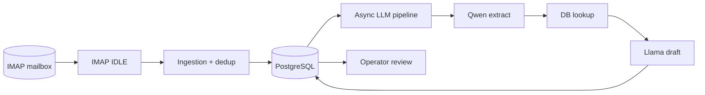
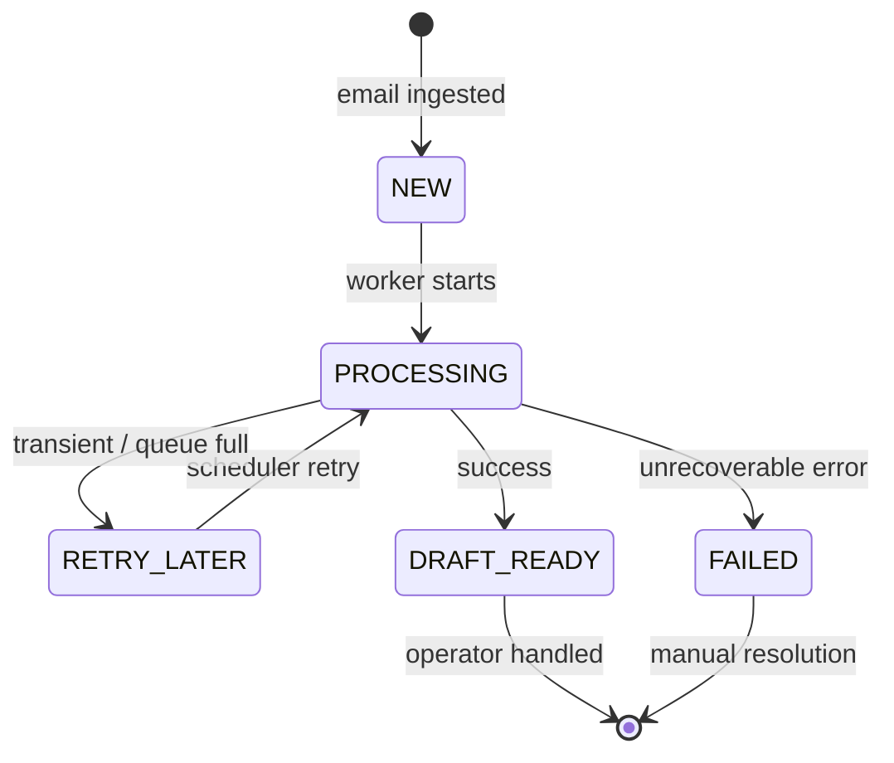
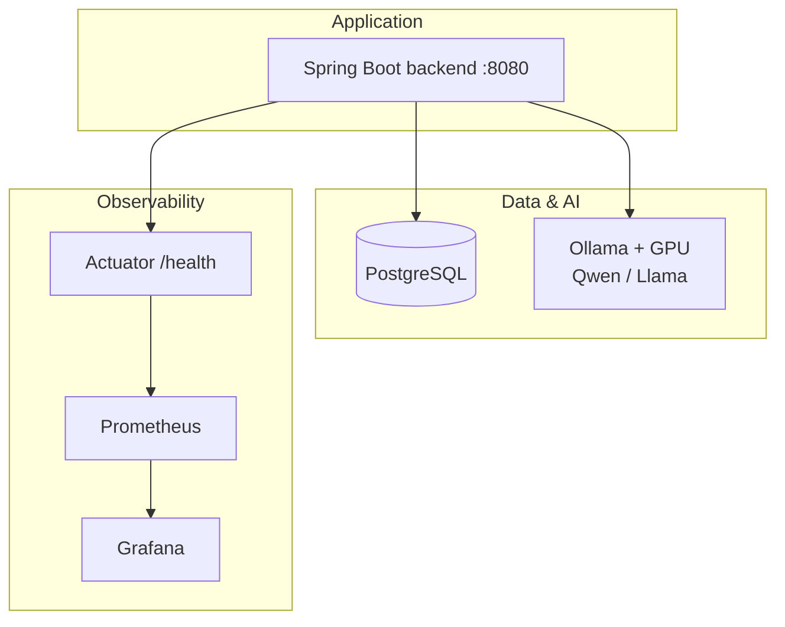
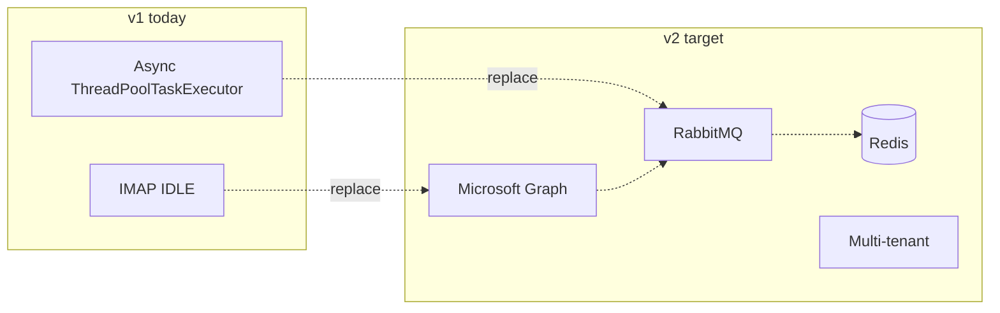
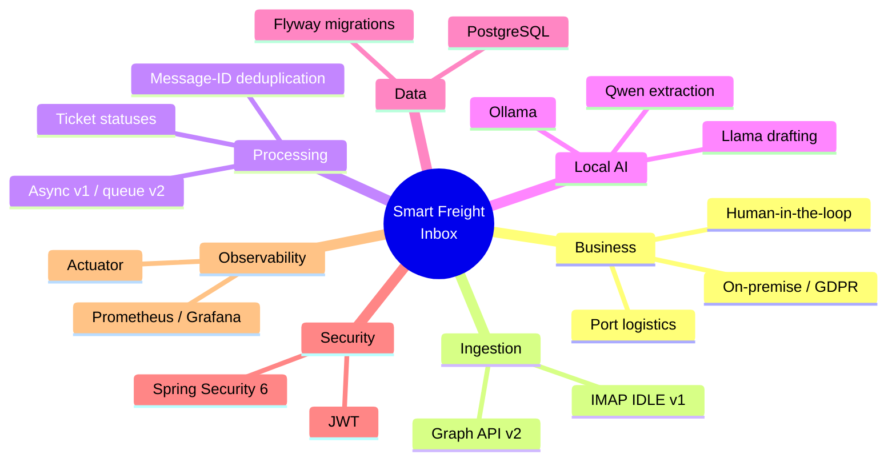
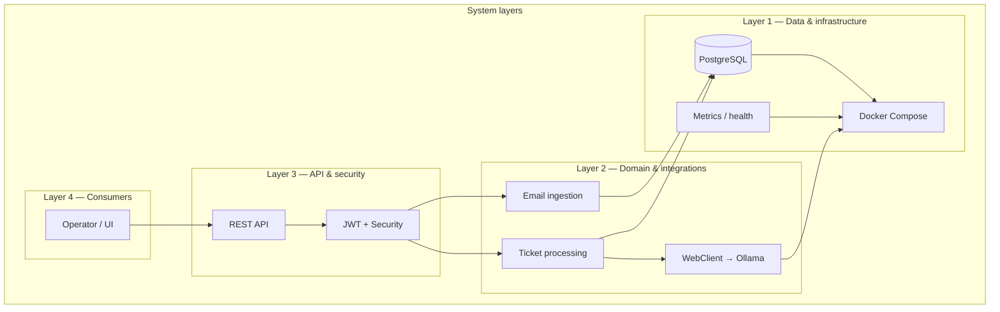
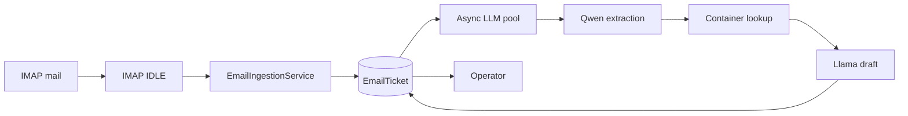
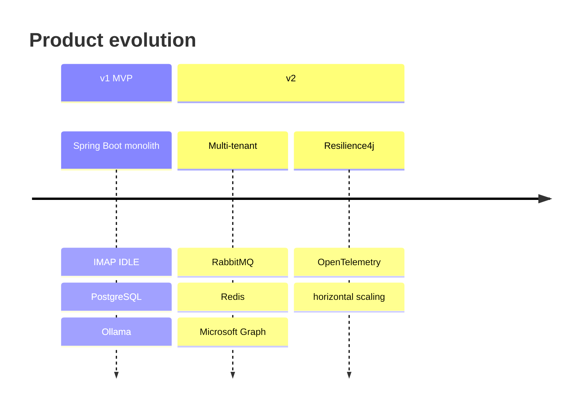

# Smart Freight Inbox — presentation map & diagrams

**How to use:** copy **Mermaid** blocks into [mermaid.live](https://mermaid.live), Marp, Notion, or GitHub.  
For PowerPoint: export PNG/SVG from mermaid.live.

You can add a university logo and a “risks / metrics” slide next to the Observability block for your committee.

---

## 1. Flow diagrams (recommended for slides)

### A. End-to-end pipeline (v1 MVP)

Mail intake, persistence, async LLM processing, operator handoff.

```mermaid
flowchart TB
  subgraph INGEST["1 — Email ingestion"]
    direction TB
    MS[(Mail server<br/>IMAP)]
    IDLE[IMAP IDLE<br/>Spring Integration]
    SVC[EmailIngestionService]
    DUP{Message-ID<br/>already in DB?}
    MS --> IDLE --> SVC --> DUP
    DUP -->|yes| SKIP[Skip duplicate]
    DUP -->|no| SAVE[Save EmailTicket<br/>status NEW]
  end

  subgraph PROC["2 — AI processing (async thread pool)"]
    direction TB
    TPS[TicketProcessingService<br/>@Async llmTaskExecutor]
    ST1[Set status PROCESSING]
    QW[Qwen 2.5 via Ollama<br/>extract container number]
    CL[Container lookup<br/>PostgreSQL]
    LL[Llama 3.1 via Ollama<br/>draft reply]
    ST2[Set status DRAFT_READY]
    SAVE --> TPS
    TPS --> ST1 --> QW --> CL --> LL --> ST2
  end

  subgraph DATA["3 — Data store"]
    PG[(PostgreSQL<br/>EmailTicket, Container, User)]
    ST1 -.-> PG
    QW -.-> PG
    CL --> PG
    LL -.-> PG
    ST2 --> PG
    SAVE --> PG
  end

  subgraph OPS["4 — Human-in-the-loop"]
    UI[Operator UI / API<br/>future]
    ST2 --> UI
  end

  subgraph RES["Resilience"]
    RL[RETRY_LATER on queue full]
    FL[FAILED on errors]
    TPS -.-> RL
    TPS -.-> FL
  end
```

### B. Simplified linear flow (single slide)



### C. EmailTicket state machine



### D. Runtime & observability (Docker stack)



### E. Planned v2 delta (context slide)



---

## 2. Mindmap (v1 + path to v2)



---

## 3. Layered architecture (nested view)

*Not a data treemap by area; this is a **layer hierarchy** for an “architecture” slide.*



---

## 4. Data pipeline (compact slide)



---

## 5. Java package tree (v1 repository)

```
smartfreight.inbox
├── InboxApplication
├── actuator
│   └── OllamaHealthIndicator
├── config
│   ├── AsyncConfig          ← LLM pool, MDC, rejection → RETRY_LATER
│   ├── ImapConfig           ← Spring Integration, mailChannel
│   ├── SecurityConfig
│   └── WebClientConfig      ← Ollama timeouts, connection pool
├── entity
│   ├── EmailTicket
│   ├── Container
│   ├── User
│   └── enums / TicketStatus
├── repository
│   ├── EmailTicketRepository
│   ├── ContainerRepository
│   └── UserRepository
├── integration
│   └── EmailIngestionService
├── service
│   └── TicketProcessingService
├── security
│   ├── JwtService
│   └── JwtAuthenticationFilter
└── exception
    ├── GlobalExceptionHandler
    └── ContainerNotFoundException
```

---

## 6. Repository root (top-level files)

```
inbox/
├── pom.xml
├── docker-compose.yml       ← backend, postgres, ollama, prometheus, grafana
├── docs/
│   ├── V2_ARCHITECTURE_AND_PLAN.md
│   └── PRESENTATION_TREE_MAP.md   ← this file
├── monitoring/
│   └── prometheus.yml
├── scripts/
│   └── entrypoint.sh
└── src/main/
    ├── java/.../com/smartfreight/inbox/...
    └── resources/
        ├── application.yaml
        └── db/migration/V1__init.sql
```

---

## 7. Roadmap v1 → v2 (timeline slide)



---

*Extend with committee-specific slides (demo, risks, test strategy) as needed.*
