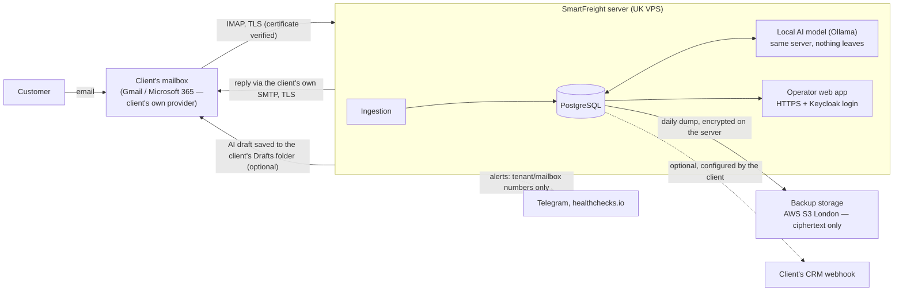

# SmartFreight — data flow, storage and deletion

*Annex to the Data Processing Agreement (Gate B8). The client is the **controller**; [Processor Ltd]
is the **processor**. Kept in the code repository so it changes with the system. Last reviewed: 5 Oct 2026.*

**In one sentence:** customer emails are read from the client's own mailbox over verified TLS,
processed by an AI model running on our own server — **no third-party AI service ever receives them**
— stored in one database on that server, and erased on request or when the contract ends.

## What is stored, where, and for how long

| Data | Where | Protection | Kept until |
|---|---|---|---|
| Email content: sender name + address, subject, body text, text extracted from PDF/Excel attachments (the raw email and attachment files are **not** stored) | PostgreSQL `email_ticket` | TLS in transit; database access only via a restricted role with row-level security per client | Contract end → erasure (below) |
| AI drafts, sent replies, audit trail (who sent what, to which address) | `email_ticket`, `ticket_audit_log` | as above | Contract end |
| Operator corrections of AI drafts + their numeric embeddings (learning) | `training_example` | as above | Contract end; the client can delete any entry on the *Learning* page |
| Client business data: rate sheets, uploaded documents (e.g. POD, bill of lading), knowledge base, settings | `carrier_rate`, `tenant_document`, `knowledge_doc`, `tenant_setting` | as above | Contract end; deletable by the client in the app |
| Follow-up / shipment-tracking subscriptions (customer email + shipment reference) | `quote_follow_up`, `shipment_watch` | as above | Contract end |
| Webhook deliveries (ticket number, subject, sender) — only if the client configures a webhook | `webhook_delivery` → the client's own endpoint | HTTPS only, HMAC-signed | Contract end |
| Mailbox credentials (app password) | `tenant_mailbox` | AES-256-GCM; the key is held outside the database | Mailbox removed / contract end |
| Operator accounts: name, email, role, password hash | Keycloak database | passwords hashed by Keycloak; brute-force protection | Account removed / contract end |
| Transient: processing queue (ticket numbers only), rate-sheet cache | RabbitMQ, Redis | internal network only | Seconds / 10 minutes |
| Application logs | container logs on the server | contain ticket/client **numbers**, not email content or customer addresses; web access logs contain client IP addresses | Rotated: 5 × 20 MB per container |
| Operational metrics | Prometheus | counts per client/mailbox number, no content | 90 days |
| Backups of the two databases | server volume + AWS S3 London | encrypted **on our server** before upload (rclone crypt: XSalsa20-Poly1305, scrypt-derived key); the storage provider holds ciphertext only | 7 daily / 4 weekly / 6 monthly on the server; ≤ 200 days offsite |

**AI processing.** Classification, extraction and drafting run on open-weight models (Qwen 2.5,
Llama 3.1, nomic-embed-text) inside Ollama on the same server. Prompts and outputs are not sent to any
external AI provider and are not used to train any shared model; the learning from operator
corrections stays within the client's own data.

**The client's mailbox.** We read it (IMAP), mark processed messages as read, and — only if enabled —
save AI drafts into its Drafts folder. We never delete or move the client's email.

## Third parties (sub-processors)

| Who | Why | Personal data |
|---|---|---|
| VPS hosting provider — *to be confirmed at provisioning, UK region* | runs the server | everything above, at rest on its disks |
| Amazon Web Services (S3, London) | offsite backups | ciphertext only — not readable without our key |
| Telegram, healthchecks.io | alerts to the processor's staff | none — client/mailbox **numbers** and alert names only |

Google / Microsoft provide the client's mailbox under the client's own contract with them.

## Deletion

- **On request or at contract end:** all of the client's data is erased from the live system with a
  recorded procedure (`scripts/erase-tenant.sh`) — every client table, operator accounts, cache —
  within **30 days**, and an erasure record is provided. Other clients' data is untouched (verified by
  the procedure).
- **Backups** cannot be edited selectively: erased data disappears from them as they rotate (≤ 6 months
  on the server, ≤ 200 days offsite). Every erasure is logged; if a backup is ever restored, the
  erasure is re-applied before the system is used again.
- **The client** revokes the mailbox access it granted us (app password / Microsoft consent) and keeps
  its own mailbox, which we never altered beyond read flags and drafts.

## Open points (to settle before signing)

- Hosting provider, its UK region, and whether its disks are encrypted at rest.
- Microsoft 365 clients connect via OAuth2 (in development) instead of an app password.
- Automatic retention (e.g. "delete tickets older than N months") is not yet available — data is kept
  for the contract term unless the client deletes it or asks us to.
